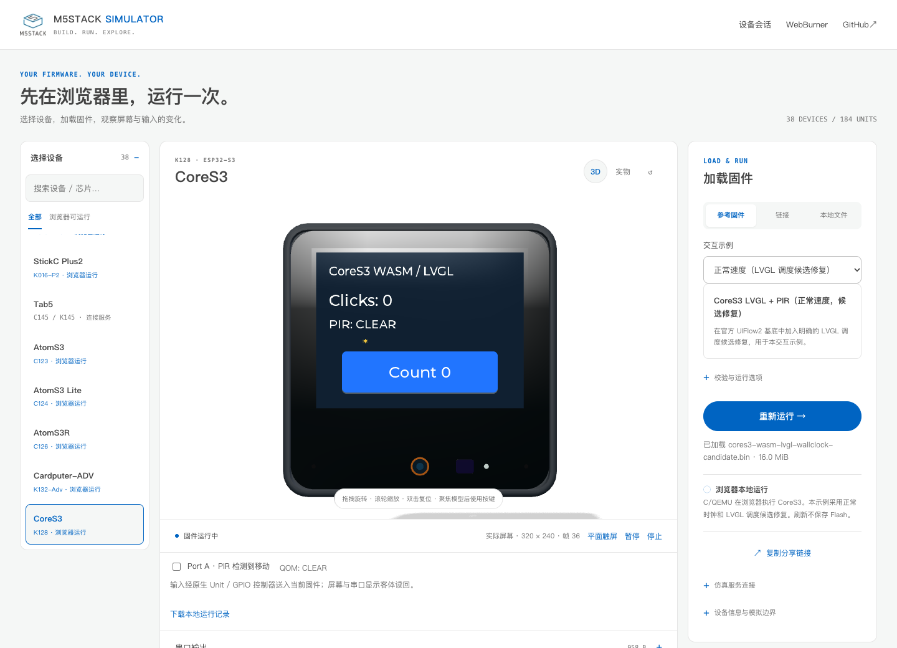

# M5Stack Firmware Simulation Platform

[简体中文](README.md) · English

[](https://github.com/m5agent/m5stack-esp-emulator/actions/workflows/ci.yml)

Run M5Stack firmware in a browser or a local service. Inspect the display and serial output, operate buttons and touch, and exercise modeled peripherals. The platform uses C/QEMU and independent device backends. UIFlow2 has the broadest validated coverage. Compatible Arduino, ESP-IDF, and MicroPython images can also run.

**[Try online](https://m5agent.github.io/m5stack-esp-emulator/)** · [Documentation](docs/README.md) · [Device Service API](docs/device-service-api.md) · [Backend migration](docs/esp32sim-migration.md) · [Report an issue](https://github.com/m5agent/m5stack-esp-emulator/issues)



*Recorded browser run. See [image provenance and reproduction](docs/images/README.md).*

## Current status

- **Online workbench.** GitHub Pages serves the browser WASM build. See the [Pages guide](docs/pages-deployment.md) for the deployed version and available devices. The 3D catalog marks devices that can execute firmware.
- **Local Device Service.** Use `/api/v1` to manage images, sessions, displays, controller input, and evidence. Version 1.99.5 was validated with the original Tab5 UserDemo dual-microphone recording and playback. Admission depends on the board, firmware, and runtime. [Project status](docs/project-status.md) · [Validation ledger](docs/validation-ledger.md)
- **Firmware review.** Reviews distinguish image admission, application behavior, and model gaps. Saved snapshots support original Core2 and Cardputer ADV re-review with source and results retained. [Review workflow](docs/firmware-review-and-simulation-workflow.md)

## Remaining work

- **P0.** Continue fast Dial input, same-BIN Core2 2048 hardware comparison, stock firmware storage and controlled networking, and Tab5 startup, RTC, and crash observations.
- **P1 / P2.** Extend Unit, PCM, sensor, and USB data paths and refine board- and runtime-specific review outcomes.

See the [project backlog](docs/project-backlog.md) for open issues, priorities, and acceptance criteria. Model limitations are in the [runtime gap register](docs/runtime-model-gap-register.md).

## Run online

Open the [workbench](https://m5agent.github.io/m5stack-esp-emulator/) in desktop Chromium. Select a device with browser execution and start the UIFlow2 programming environment or a fixed example. Once the programming environment is ready, run MicroPython in the editor. Verify behavior in the display and serial log, then stop the guest.

Browser execution requires HTTPS, a Service Worker, and shared memory. The first startup downloads and verifies WASM, the ROM, and firmware. Review the [image and board requirements](docs/pages-deployment.md#访问者流程与浏览器要求) before importing a BIN.

## Run locally

Use Python 3.12+ to start the workbench.

```bash
git clone https://github.com/m5agent/m5stack-esp-emulator.git
cd m5stack-esp-emulator
./start.sh
```

Open <http://127.0.0.1:8787/>. Use `PORT=8890 ./start.sh` for another port. A fresh checkout serves the workbench and API. Follow the [deployment guide](docs/deployment.md) to prepare the matching runtime, ROM, and firmware before creating a native guest. Check `ready` conditions, serial output, and guest frames for application readiness. [OpenAPI](docs/device-service.openapi.yaml)

## Agents and development

| Task | Entry point |
| --- | --- |
| Upload, run, and collect firmware evidence | [Firmware simulation Skill](skills/m5stack-esp-emulator/SKILL.md) |
| Run UIFlow2 code in the same virtual device | [UIFlow2 Skill](skills/uiflow2-simulator/SKILL.md) |
| Import firmware and inspect a display in the browser | [Browser Skill](skills/m5stack-browser-simulator/SKILL.md) |
| Maintain the platform and run verification | [AGENTS.md](AGENTS.md) · [Engineering handoff](docs/engineering-handoff.md) · [Code map](docs/code-map.md) · [Workstreams](docs/workstreams.md) · [Tests](tests/README.md) |

Capabilities and evidence apply to a specific device, image, and runtime. Tab5, CardputerZero, and Xtensa WASM have independent support boundaries. Physical RF, power, acoustics, and electrical behavior require hardware evidence. Deploy on a trusted host with an appropriate network isolation policy. [Firmware admission](docs/firmware-manifest.md) · [Skill installation](skills/README.md)

Issue reports should include the board, runtime/profile, firmware SHA-256, reproduction steps, and redacted evidence.

## License and acknowledgements

Original code and documentation use the [MIT License](LICENSE). QEMU, third-party code, and device models follow the [applicable notices](THIRD_PARTY_NOTICES.md).
