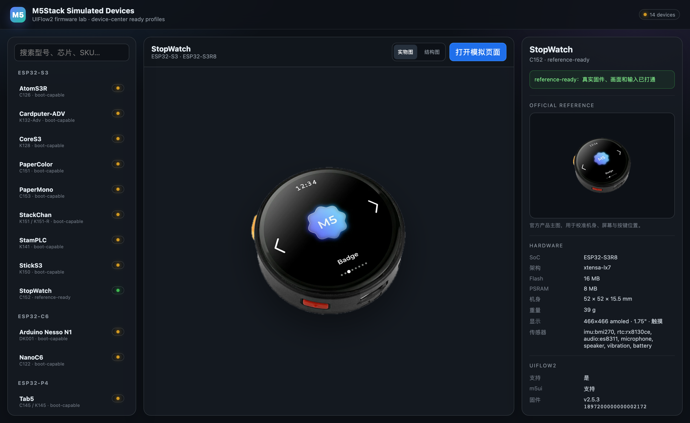

# M5Stack Firmware Simulation and Review Platform

Last reconciled: `2026-10-26`

[](https://github.com/m5agent/m5stack-esp-emulator/actions/workflows/ci.yml)

面向 M5Stack 多主控固件启动、烧录、UI 预览、外设联调和自动测试的模拟平台。
当前验证最完整的是 UIFlow2，但架构也支持满足兼容条件的 ESP-IDF、Arduino、
MicroPython 和其他完整 Flash 固件。



## 当前状态

- 后端覆盖 ESP32-S3、ESP32-C6、ESP32 LX6、ESP32-P4 和独立 Linux ARM64。
  S3/C6/Core2 的规范整机路径是 `qemu-unified`
  （`runtime=qemu-unified`）：同一 lease、同一 guest 内执行板级、WiFi、
  BLE 和 evidence。Core2 使用
  `profile=core2-native-hci`；GDB VHCI 仅用于诊断。
- Device Service 提供 lease、虚拟烧录、串口、frame/input/QOM、worker job、
  网络故障、pcap 和 evidence；普通 Agent 功能测试统一走 `/api/v1`，并在
  Live sessions 中保留可观察历史。
- 网络路径已有 controlled DNS/CNAME、有界 IPv4/IPv6 egress、WPA2 正误
  密码、断线恢复、双 guest fabric 和 pcap。Worker 路径已有 durable queue、
  HMAC、HTTPS/mTLS、rotation、discovery、restart/reattach、
  control/runtime 分离、跨容器 QEMU 和 partition fence。
- Core2 已具备 native-HCI、WiFi/公网/GATT、重连、长稳、active-stop、
  8 MiB PSRAM QOM 和当前服务容量内的并发 virtual-device 门禁。能力范围
  不以轮次或某一批 PASS 表示；精确结果、失败 control 和运行参数只查
  [验证证据台账](docs/validation-ledger.md)。大于当前容量、持续吞吐、
  物理 PSRAM/cache timing、bit-exact BT controller 和真机仍未完成。
- Core2 legacy UIFlow 仍为 `PARTIAL`。共享板级 I2C、`CCOMPARE == CCOUNT`
  equal-deadline timer、TIMG WDT mask 和保留 m25p80 状态的 QIO/stateful
  SSI 批量数据面及 `0037` 统一 cross-core timeline、`0038` exact-time
  pause、`0039` state sweep 和 `0040` setter trace 已验证，但同一 public
  firmware 仍会由 TG0 stage-1 watchdog reset，且没有同 SHA 非空应用帧。
  WDT liveness 显示 TG1 在 reset 前仍持续 feed，历史 `800 ms` gap 为
  `NOT_REPRODUCED`；WDT-off 对照随后停在 CPU1 `0x40100049` 的
  flash-cache/IPC/DPORT late-loop。当前门禁是绑定该 late object 并取得
  matching ELF/MAP；`RUNTIME-03` 的完整证据与边界只在
  [项目当前状态](docs/project-status.md)和
  [验证证据台账](docs/validation-ledger.md)维护。
- 固件侧支持 UIFlow、ESP-IDF、Arduino、MicroPython、merged/segmented、
  WebBurner/M5Burner、文件系统/NVS/SD fixture、静态和 capability 审查。
  `qemu-wifi/profile=generic-observe` 为非 UIFlow 或 network-first 固件
  提供最小执行路径。
  Secure Boot v2 已有镜像数学与包内摘要对照；live trust root、生产 key、
  运行态 ACL/许可和完整云端业务仍未闭环。
- 所有 QEMU/esp-emu 结论只标记为 `virtual-device validation`。物理 RF、
  功耗、声学、光学、机械、电气和真机安全配置必须由同路径硬件证据单独证明。

具体计数、逐次运行和最新边界请先读
[工程交接总览](docs/engineering-handoff.md)，再读
[自动项目快照](docs/project-snapshot.md) 和
[项目当前状态](docs/project-status.md)；README 不复制会随提交变化的结果。
按工作流查看工作归属见[工作流总台账](docs/workstreams.md)，代码入口见
[代码与验证入口地图](docs/code-map.md)，带日期的 evidence 见
[验证证据台账](docs/validation-ledger.md)。

## 下一步

未完成项、优先级、依赖和验收只在
[项目 Backlog](docs/project-backlog.md)维护。自动快照会同步展示其中的 Task
板；README 不再保存第二份执行顺序。

关键索引：

- [工程交接总览](docs/engineering-handoff.md)
- [文档导航与新鲜度规则](docs/README.md)
- [自动项目快照](docs/project-snapshot.md)
- [工作流总台账](docs/workstreams.md)
- [项目当前状态](docs/project-status.md)
- [完整项目 Backlog](docs/project-backlog.md)
- [代码与验证入口地图](docs/code-map.md)
- [验证证据台账](docs/validation-ledger.md)
- [设备高保真建模 Backlog](docs/device-visual-fidelity-backlog.md)
- [热门用户固件仿真矩阵](docs/user-firmware-simulation-matrix.md)
- [运行时模型缺口登记](docs/runtime-model-gap-register.md)
- [Tab5 暂缓项](docs/tab5-deferred-backlog.md)
- [网络模拟方案](docs/network-simulation-plan.md)
- [统一设备运行时契约](docs/unified-device-runtime.md)

## 快速开始

```bash
./start.sh
```

默认地址：

- 设备目录：<http://127.0.0.1:8787/platform/web/>
- 会话观察：<http://127.0.0.1:8787/platform/web/sessions.html>
- WebBurner 固件导入：<http://127.0.0.1:8787/platform/web/firmware.html>
- 设备服务 API：<http://127.0.0.1:8787/api/v1>
- OpenAPI：<http://127.0.0.1:8787/api/v1/openapi.yaml>

这条命令不需要 `.work/`，可以启动设备目录、只读设备清单和 OpenAPI 页面。
`.work/` 是本地构建与运行时缓存，已被 `.gitignore` 排除；全新 clone
**不会**包含它，因此也不能只靠 clone 创建 QEMU 会话。

需要创建、烧录和操作虚拟设备时，请按
[部署与运行时资产](docs/deployment.md) 准备对应资产。

也可以直接启动：

```bash
python3 platform/tools/serve.py 8787
```

`8787` 是本项目默认端口；本机 `8080` 已被其他 Docker 服务占用。

## 设备服务

其他 Agent 可以按 lease 创建独占虚拟设备：

```bash
curl -sS -H 'Content-Type: application/json' \
  -d '{"device_id":"sticks3","ttl_seconds":600}' \
  http://127.0.0.1:8787/api/v1/sessions
```

主要能力：

- reference UIFlow2 固件或上传的 merged/segmented 固件；
- 真实 esptool 虚拟烧录和 prepared-flash cache；
- 每 session 独立虚拟 Flash；
- 串口、QEMU 日志、PNG framebuffer；
- 按键/触摸/拖拽、QOM、reset、renew、stop；
- Linux namespace 下的 nftables 精确 IPv4/IPv6 地址/协议/端口 allowlist、
  controlled DNS A/AAAA/CNAME、TLS Host decision 和 per-session 双栈
  veth/NAT；
- application readiness、evidence ZIP、QOM/flash snapshot/diff；
- 停止会话前保存最后一帧，历史会话仍可查看串口和最后画面；
- stopped/failed 历史按时间、条数和字节数自动回收；停止后默认释放整份
  可变虚拟 Flash，仅在需要 Flash 快照/diff 时用 `retain_flash=1` 保留；
- 无引用的 artifact、firmware、prepared-flash 缓存和中断的上传
  staging 按 grace period GC；
- `GET /api/v1/storage` 查看磁盘、历史与缓存占用，写入前保留最低空闲空间；
- 全局和单设备并发限制、TTL 自动回收。

当前工作站默认允许 `12` 个活动会话，同一型号最多 `8` 个。可通过
`M5_SERVICE_MAX_SESSIONS`、`M5_SERVICE_MAX_PER_DEVICE` 或对应 CLI 参数调整；
满载时超出容量仍返回 `429` 和 `Retry-After`。

`running` 只表示虚拟主机控制通道已启动；应用就绪请使用 `ready_marker`、
串口标记或非空截图确认。

人工观察页默认显示活动租约，以及最近 30 分钟内保存了最后一帧或串口的
完成会话；`显示全部历史` 可展开更早记录。API 可用
`GET /api/v1/sessions?include_stopped=0` 只取活动租约，也可从页面或
`DELETE /api/v1/sessions?state=stopped&purge=1` 清理历史。
清除历史后可用 `POST /api/v1/storage/prune?include_cache=1` 同步回收不再
被会话或 firmware 引用的 artifact、firmware 和 prepared-flash 缓存。

完整接口和示例见：

- [Device Service API](docs/device-service-api.md)
- [OpenAPI 3.1](docs/device-service.openapi.yaml)

## 设备支持

设备清单由 `devices/catalog.source.json` 和
`platform/qemu/profiles.json` 维护，验证日期、外设状态和 blocker 由
[自动项目快照](docs/project-snapshot.md)生成。这里不再复制第二份设备表。

- ESP32-S3/C6/LX6 的规范整机路径是 `runtime=qemu-unified`：同一 lease
  中包含板级、WiFi、BLE 和 evidence；具体设备覆盖与边界见快照和当前状态。
- Tab5 使用独立 P4 后端，当前外设状态是 `partial`。
- CardputerZero 使用独立 Linux ARM64 后端，不属于 ESP32/UIFlow2 路径。

CoreS3 的 UIFlow2 启动菜单顶部图标目前存在条纹伪影，reference 固件同样可复现；
普通文字、矩形、RGB PNG 和自定义不透明绘制正常。该问题跟踪为
[CoreS3 图像渲染边界](docs/cores3-image-rendering-boundary.md)，不影响启动、
烧录和像素级 UI 测试，但尚不能称为完全视觉保真。

逐设备机器可读状态和 blocker 见
[自动项目快照](docs/project-snapshot.md)；设备档案见
[`devices/README.md`](devices/README.md)，后端映射见
[`docs/qemu-device-adaptation-matrix.md`](docs/qemu-device-adaptation-matrix.md)。

## 固件与审查

当前输入支持：

- UIFlow1/UIFlow2
- ESP-IDF
- Arduino ESP32
- MicroPython
- 其他完整 merged Flash 或带地址的分段镜像

兼容前提是芯片、板级 profile、Flash/PSRAM/eFuse、分区布局和控制器模型匹配。
当前底层烧录工具可接受通用镜像；`fetch_firmware.py --firmware-id` 可校验公开
状态与支持设备、按当前 metadata 下载社区固件并运行结构与脱敏静态审查。设备级兼容
仍需按具体 SoC/板级 profile 和控制器覆盖验证。

固件审查流程、证据分层和安全边界见：

- [固件审查与仿真测试工作流](docs/firmware-review-and-simulation-workflow.md)
- [WebBurner 浏览器固件导入](platform/web/firmware.html)
- [虚拟设备功能测试入口与持久化规则](docs/device-functional-test-workflow.md)
- [外设仿真架构](docs/peripheral-simulation-architecture.md)
- [UIFlow2 外设测试矩阵](docs/uiflow2-peripheral-test-matrix.md)

## 本地开发依赖

设备目录、只读设备清单 API 和 OpenAPI 只需要 Python 3。需要 lease、
烧录、串口、截图或输入的 `/api/v1/sessions` 路径时，还必须有匹配当前
commit 与主机架构的 `.work/` 运行时：

macOS arm64 + Python 3.13 可直接使用已验证的
[运行时包](https://github.com/m5agent/m5stack-esp-emulator/releases/tag/runtime-macos-arm64-2026.10.25)，
解压后即可启动 Device Service。包内包含 QEMU、ROM、`esp-emu` 和 Python
依赖，但不包含参考固件，也不替代 Linux/Windows 构建或 clean-room 源码重建。

- `.work/M5StopWatch-QEMU/`：按补丁构建的 QEMU；
- `.work/esp-emu-versions/0.50.0/`：Tab5 P4 和 network 诊断 lane 使用的
  `esp-emu`；
- Espressif QEMU ROM/eFuse 文件；
- 可选 `UIFLOW_MICROPYTHON_DIR`：UIFlow2 源码 checkout；
- LittleFS 清单：`python3 -m pip install littlefs-python`（缺失时 manifest
  记录 `UNAVAILABLE`）；
- FAT12/16/32 清单使用内置只读 parser，不需要宿主挂载或额外工具；
- SPIFFS 常见 page/block/name/meta 配置使用内置只读 parser，不执行镜像；
- 内置 UIFlow2 缓存：`python3 platform/tools/fetch_firmware.py <device>`；
- 任意公开社区固件：
  `python3 platform/tools/fetch_firmware.py --firmware-id <id> --device-slug <slug> --analyze --chip-id 0x9 --cache /tmp/m5-firmware`。

固件、ROM、QEMU 二进制和构建目录均被 `.gitignore` 排除。
`fetch_firmware.py` 只下载参考固件，不会生成 QEMU 运行时。

## 验证入口

每次改动先运行窄验证：

```bash
PYTHONPATH=platform/tools python3 -m unittest discover \
  -s platform/tests -p 'test_*.py'
python3 platform/tools/runtime_coverage.py --check
python3 platform/tools/peripheral_catalog.py --check
python3 platform/tools/qemu_profiles.py --check
python3 platform/tools/project_snapshot.py --check
```

相关外设用例：

```bash
PYTHONPATH=.work/py python3 tests/uiflow2/run_peripheral_matrix.py \
  --case <case-id> --out-dir /tmp/m5-<case-id>
```

全量矩阵只在发布、里程碑或跨设备大改时运行：

```bash
PYTHONPATH=.work/py python3 tests/uiflow2/run_peripheral_matrix.py \
  --out-dir /tmp/m5-uiflow2-peripheral-matrix
```

## 文档索引

- [文档导航与新鲜度规则](docs/README.md)
- [自动项目快照](docs/project-snapshot.md)
- [项目当前状态](docs/project-status.md)
- [项目 Backlog](docs/project-backlog.md)
- [代码与验证入口地图](docs/code-map.md)
- [验证证据台账](docs/validation-ledger.md)
- [测试入口与 evidence 规则](tests/README.md)
- [QEMU / 固件补丁总索引](patches/README.md)
- [设备服务架构](docs/simulator-service-architecture.md)
- [设备服务 API](docs/device-service-api.md)
- [设备高保真建模 Backlog](docs/device-visual-fidelity-backlog.md)
- [虚拟主机适配矩阵](docs/qemu-device-adaptation-matrix.md)
- [外设仿真架构](docs/peripheral-simulation-architecture.md)
- [固件审查工作流](docs/firmware-review-and-simulation-workflow.md)
- [网络模拟方案](docs/network-simulation-plan.md)
- [网络诊断 lane](docs/network-lane.md)
- [双设备 private lab fabric](tests/network/lab_fabric/README.md)
- [TLS Host allowlist fixture](tests/network/tls_allowlist/README.md)
- [Worker HTTPS/mTLS transport](tests/network/worker_tls/README.md)
- [固件清单与 WebBurner 导入](docs/firmware-manifest.md)
- [固件验证 evidence 目录](tests/firmware/README.md)
- [统一设备运行时契约](docs/unified-device-runtime.md)
- [Tab5 暂缓项](docs/tab5-deferred-backlog.md)
- [维护与验证规则](AGENTS.md)

## 边界

- 仿真 PASS 不等于真机 PASS。
- S3/C6/Core2 的 QEMU 网络是 MAC/DMA 与 user-net 数据面，不是完整
  PHY/RF/天线模型。
- C6 软件复位后的 chip-id 错误已作为 Flash 地址宽度/PMP 模型缺陷修复；
  Zigbee/802.15.4 仍是 `OPEN` 运行时模型缺口。
- `egress=allowlist` 的网络策略覆盖 IPv4/IPv6 地址或有界 CIDR、协议和
  端口，IPv6 路径包含 neighbor discovery、veth 路由与 masquerade；
  controlled resolver 支持 exact A/AAAA、显式绑定的 domain suffix 和
  最多 8 跳 CNAME chain。
  专用 UIFlow2 测试构建已在同一 guest 完成 IPv6 TCP/HTTP；原厂 UIFlow2
  没有创建 IPv6 link-local。Linux namespace 内同一 guest 的 controlled
  AAAA、allowed IPv6 HTTP、denied-port、pcap、cleanup 和 QEMU reap 已
  PASS；CNAME resolver 和三个独立同 guest CNAME→HTTP lease 均通过。
  任意公网域名解析、DNSSEC 和恶意固件 VM 隔离仍不在该结论内。
- BLE 默认是 HCI-UART offload 到 Bumble；Core2 另有 stock
  internal-controller 路径。规范主路径是 QEMU
  `runtime=qemu-unified/profile=core2-native-hci`。旧的
  `core2-native-vhci` 依赖 GDB 暂停、callback 注入和 synthetic return，只保留
  为显式诊断/兼容路径。具体 hold、reconnect 和 HLI health 证据见
  [Core2 native HCI backend](docs/core2-native-hci-backend.md)和验证台账。
- Core2 的 bounded TCG、长稳、reconnect、active-stop/recovery、PSRAM
  压力和当前容量内并发均有 virtual-device evidence；这些结果不外推到
  更大规模、持续吞吐、active-stop 之外 teardown、物理 cache/PSRAM 或真机。
  当前默认使用固定 `icount shift=5`，旧 `shift=auto` 的失败和延迟 trace
  继续保留。轮次、RSS、时长和失败比例只在验证证据台账与 evidence 中维护。
- `runtime=network` 的 SoftAP/hostfwd 是 provisioning 诊断路径，不是恶意
  固件沙箱。
- Tab5 外设不完整，但烧录、启动、串口、1280×720 画面和触摸可用。
- CardputerZero 不是 UIFlow2/ESP32 固件目标。
- 公开仓库不包含第三方固件、ROM、设备标识或云端凭据。

## 参考项目与致谢

本项目的多主控适配和验证流程参考了以下公开项目：

- [zqqf16/M5StopWatch-QEMU](https://github.com/zqqf16/M5StopWatch-QEMU)：
  StopWatch QEMU 适配、板级模型与早期 UI 验证思路的重要参考。
- [espressif/esp-emulator](https://github.com/espressif/esp-emulator)：
  ESP32-C3/C6/P4 RISC-V 运行时、esptool 下载接口、UART/GDB 控制能力。
- [espressif/qemu](https://github.com/espressif/qemu)：
  ESP32/S3/P4 QEMU SoC 与板级模型的源码基础。
- [m5stack/uiflow-micropython](https://github.com/m5stack/uiflow-micropython)：
  UIFlow2 固件构建、板型配置和 MicroPython API 来源。
- [m5stack/M5GFX](https://github.com/m5stack/M5GFX) 与
  [m5stack/M5Unified](https://github.com/m5stack/M5Unified)：
  显示、触摸、板型探测和设备外设路径。
- [espressif/esp-toolchain-docs](https://github.com/espressif/esp-toolchain-docs)：
  QEMU 与 esptool/ESP-IDF 联调方法的公开文档。
- [m5stack/m5stack-linux-dtoverlays](https://github.com/m5stack/m5stack-linux-dtoverlays)：
  CardputerZero 官方 Linux 设备树 overlay 来源。
- [CardputerZero/FactoryTest](https://github.com/CardputerZero/FactoryTest)：
  CardputerZero 官方外设探测、音频、摄像头和电源接口行为参考。
- [torvalds/linux `sound/soc/codecs/es8389.c`](https://github.com/torvalds/linux/blob/master/sound/soc/codecs/es8389.c)
  与 [bouffalolab/bouffalo_sdk `audio_codec_es8389.c`](https://github.com/bouffalolab/bouffalo_sdk/blob/master/bsp/common/audio_codec/audio_codec_es8389.c)：
  ES8389 寄存器布局、身份寄存器与编解码控制路径参考。
- [Linux `r8152.c`](https://github.com/raspberrypi/linux/blob/rpi-6.6.y/drivers/net/usb/r8152.c)
  与 [CoreChips SR9900A 数据手册](https://www.lcsc.com/datasheet/C521278.pdf)：
  SR9900A 的 RTL8152-compatible USB 控制、TX/RX 描述符和以太网数据面参考。
- [Genesys Logic GL852G 数据手册](https://www.lcsc.com/datasheet/C7501404.pdf)：
  `05e3:0610` 默认身份、四口 Hub 与 USB 2.0 行为参考。

各组件的许可与二进制再分发边界见
[`THIRD_PARTY_NOTICES.md`](THIRD_PARTY_NOTICES.md)。

## License

项目原创代码与文档采用 [MIT License](LICENSE)。QEMU 补丁、WASM、产品参考图
和上游代码片段遵循各自许可，见 [`THIRD_PARTY_NOTICES.md`](THIRD_PARTY_NOTICES.md)。
