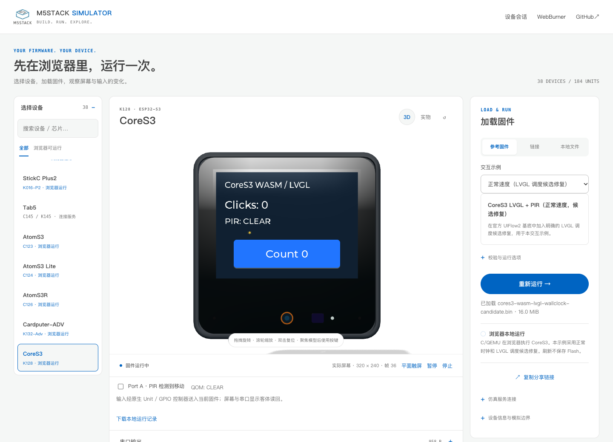
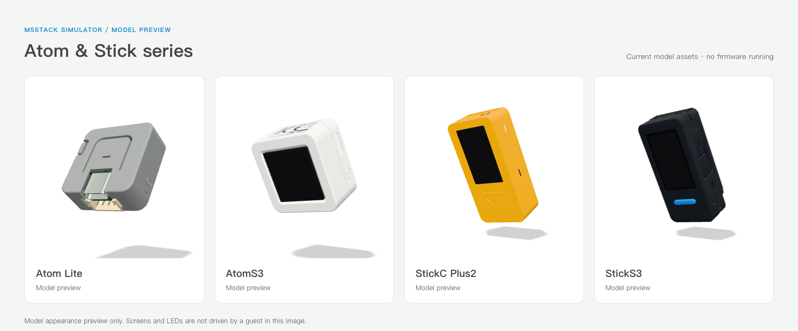

# M5Stack 固件模拟平台

简体中文 · [English](README.en.md)

[](https://github.com/m5agent/m5stack-esp-emulator/actions/workflows/ci.yml)

在浏览器或本地服务中运行 M5Stack 固件，观察屏幕、操作按键和触摸，联调已覆盖的外设，并保存可复查的运行证据。
平台基于 C/QEMU 和独立设备后端；UIFlow2 的验证覆盖最完整，也支持经过兼容性检查的 Arduino、ESP-IDF 和 MicroPython 镜像。

**[在线体验](https://m5agent.github.io/m5stack-esp-emulator/)** · [功能与边界](docs/project-status.md) · [文档](docs/README.md) · [问题反馈](https://github.com/m5agent/m5stack-esp-emulator/issues)



*本轮实际浏览器运行截图；[图片来源与复现](docs/images/README.md)。线上部署与 main 可能不同，版本及部署方式见 [Pages 指南](docs/pages-deployment.md)。*

## 选择运行方式

| 方式 | 用途 | 前提与范围 |
| --- | --- | --- |
| 浏览器 WASM | 打开网页，运行参考示例或兼容的完整 Flash 镜像 | 仅开放已准入的设备与配置；无需 Device Service |
| 本地 Device Service | 虚拟烧录、串口/画面/输入、外设与网络测试、自动化取证 | 需要匹配的运行时、ROM 和固件；通过 `/api/v1` 管理会话 |
| 3D 模型预览 | 查看设备与 Unit 外壳、接口和交互 | 模型可见不代表已有固件执行后端 |

浏览器使用客体固件和模拟控制器产生画面与状态；3D 外壳用于呈现和输入。
各设备的后端、外设状态和未完成项见[自动项目快照](docs/project-snapshot.md)；
精确测试条件见[验证证据台账](docs/validation-ledger.md)。



*模型目录示意；各型号的固件执行能力需单独验证。*

## 在线体验

1. 用桌面 Chromium 浏览器打开[在线站点](https://m5agent.github.io/m5stack-esp-emulator/)。
2. 选择标有“浏览器运行”的设备和参考固件，启动后等待应用画面或就绪标记。
3. 操作设备上的按键、触摸或已覆盖输入，查看串口与画面；结束时点击停止。

首次使用需要下载 WASM、ROM 和固件，部分设备冷启动较慢。HTTPS、Service Worker
和共享内存是浏览器执行的前提。ROM/固件在访问者浏览器下载并校验，不随站点打包。
本地 `.bin` 或 URL 导入仍需满足选定设备的芯片、板级配置和分区要求。
详见[浏览器要求与固件范围](docs/pages-deployment.md)。

## 本地启动

建议使用 Python 3.12+：

```bash
git clone https://github.com/m5agent/m5stack-esp-emulator.git
cd m5stack-esp-emulator
./start.sh
```

打开 <http://127.0.0.1:8787/platform/web/>。也可访问[会话页](http://127.0.0.1:8787/platform/web/sessions.html)、
[固件导入](http://127.0.0.1:8787/platform/web/firmware.html)和 [OpenAPI](http://127.0.0.1:8787/api/v1/openapi.yaml)。
需要换端口时使用 `PORT=8890 ./start.sh`。

全新 clone 可启动设备目录和 API 页面；它不包含创建原生虚拟设备所需的本地运行时资产。
按[部署与运行时准备](docs/deployment.md)构建或配置匹配当前源码与主机架构的后端，
再通过工作台或 [Device Service API](docs/device-service-api.md)创建会话。
`running` 仅表示控制通道启动，应用就绪需结合 `ready_marker`、串口和实际帧判断。

## Agent Skills

部署 Device Service 的用户可以将 [skills/](skills/README.md) 中的完整目录安装到
自己的 Agent，不需要在 Agent 机器安装 QEMU：

| Skill | 用途 |
| --- | --- |
| [m5stack-esp-emulator](skills/m5stack-esp-emulator/SKILL.md) | 通用固件上传/合成/Manifest、设备与 Unit、虚拟运行、串口/画面/交互、网络/Flash 取证与会话清理 |
| [uiflow2-simulator](skills/uiflow2-simulator/SKILL.md) | AIFlow 专用 UIFlow2 完整代码/资源包、同 guest Preview/Run、报错与 UI 迭代 |

两包独立携带 helper 和参考文件，服务地址与控制 Token 由部署者配置，不包含
本机 IP 或凭据。AIFlow 版保留上游技能名和当前两阶段确认流程；通用版没有
AIFlow 运行依赖。安装、环境变量、验证及独立 ZIP 打包见 [Skill 指南](skills/README.md)。

## 能力边界

- 兼容性绑定具体设备、profile、控制器覆盖、Flash/PSRAM、分区和安全配置；
  可导入不等于能运行，单个示例通过也不等于任意固件兼容。见[固件准入](docs/firmware-manifest.md)。
- 浏览器、原生服务和物理硬件是独立验证范围。Tab5 与 CardputerZero 各有独立后端和可用子集，
  不能继承 ESP32 浏览器结果；C6、P4 和 Linux ARM64 也不是 Xtensa WASM 的自动扩展。
- 虚拟设备验证不证明物理 RF、功耗、声学、光学、机械或电气等价性。
- 当前服务面向可信主机使用，网络策略与静态审查不能代替不可信固件的生产级隔离。
- 固件差异、启动时间、输入延迟及 Worker 回收仍有已知限制。当前范围见
  [项目状态](docs/project-status.md)，具体缺口见[运行时缺口登记](docs/runtime-model-gap-register.md)。

## 开发与贡献

欢迎提交 Issue 和 PR。请附设备型号、runtime/profile、固件 SHA256、复现步骤和必要的串口/画面证据，
并去除凭据、设备标识和私有地址。提交固件二进制前先确认其授权；本仓库不收录固件或 ROM。

修改前阅读 [AGENTS.md](AGENTS.md) 及所在目录的局部指引。按影响范围运行[验证入口](tests/README.md)；
常用离线检查为：

```bash
PYTHONPATH=platform/tools python3 -m unittest discover -s platform/tests -p 'test_*.py'
python3 platform/tools/runtime_coverage.py --check
python3 platform/tools/peripheral_catalog.py --check
python3 platform/tools/qemu_profiles.py --check
python3 platform/tools/project_snapshot.py --check
```

| 需要了解 | 入口 |
| --- | --- |
| 架构与接手顺序 | [工程交接总览](docs/engineering-handoff.md) · [代码地图](docs/code-map.md) |
| 任务与工作流 | [Backlog](docs/project-backlog.md) · [工作流总台账](docs/workstreams.md) |
| 设备与外设接入 | [设备目录](devices/README.md) · [外设契约](docs/peripheral-simulation-architecture.md) |
| Agent 接入与同 guest Run | [源码到 Unit 会话](docs/unit-agent-api.md) |
| 历史验证与已知差异 | [验证台账](docs/validation-ledger.md) · [固件矩阵](docs/user-firmware-simulation-matrix.md) |

## 许可与致谢

原创代码与文档采用 [MIT License](LICENSE)。QEMU、WASM、第三方代码和模型资产遵循各自许可；
重新分发前请阅读 [THIRD_PARTY_NOTICES.md](THIRD_PARTY_NOTICES.md)。
感谢 [M5StopWatch-QEMU](https://github.com/zqqf16/M5StopWatch-QEMU)、
[Espressif QEMU](https://github.com/espressif/qemu)、[esp-emulator](https://github.com/espressif/esp-emulator)、
[UIFlow MicroPython](https://github.com/m5stack/uiflow-micropython)、
[M5GFX](https://github.com/m5stack/M5GFX)、[M5Unified](https://github.com/m5stack/M5Unified)
及[设备模型项目](https://github.com/yuyun2000/m5stack-models)提供的基础与参考。
