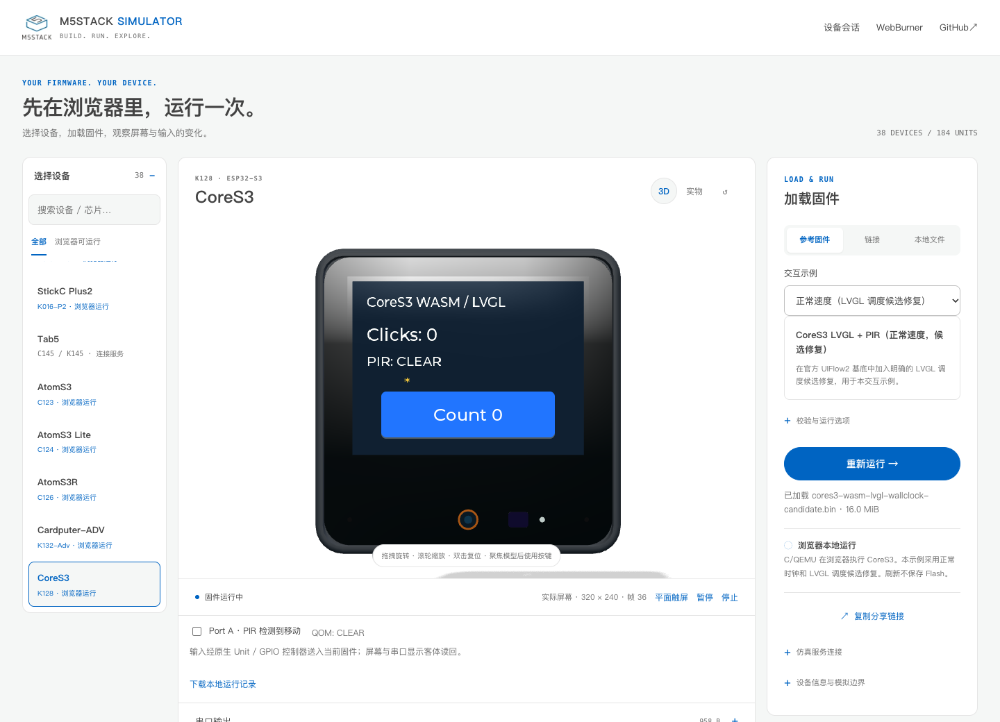

# M5Stack 固件模拟平台

简体中文 · [English](README.en.md)

[](https://github.com/m5agent/m5stack-esp-emulator/actions/workflows/ci.yml)

在浏览器或本地服务中运行 M5Stack 固件，查看屏幕和串口，操作按键、触摸与已建模外设。平台使用 C/QEMU 和独立设备后端。UIFlow2 验证覆盖最完整，兼容的 Arduino、ESP-IDF 和 MicroPython 镜像也可运行。

**[在线体验](https://m5agent.github.io/m5stack-esp-emulator/)** · [文档](docs/README.md) · [Device Service API](docs/device-service-api.md) · [后端迁移](docs/esp32sim-migration.md) · [反馈问题](https://github.com/m5agent/m5stack-esp-emulator/issues)



*已验证的运行截图。截图身份和复现步骤见[图片说明](docs/images/README.md)。*

## 当前状态

- **在线工作台**通过 GitHub Pages 提供浏览器 WASM。可用设备与正式发布版本见 [Pages 指南](docs/pages-deployment.md)。3D 目录中的每个设备另有固件执行标记。
- **本地 Device Service**通过 `/api/v1` 管理固件、会话、画面、控制器输入和取证。1.99.5 已验证 Tab5 UserDemo 原版双麦录放。其他板型、镜像和运行模式各有独立准入。[项目状态](docs/project-status.md) · [验证台账](docs/validation-ledger.md)
- **固件审核**区分镜像准入、应用行为和模型缺口。保存快照可复审原版 Core2 和 Cardputer ADV，并保留来源与结果。[审核工作流](docs/firmware-review-and-simulation-workflow.md)

## 当前剩余工作

- **P0**继续核对 Dial 快速输入、Core2 2048 同 BIN 真机对照、原版存储与受控联网，以及 Tab5 启动和 RTC/崩溃观测。
- **P1 / P2**扩充 Unit、PCM、传感器和 USB 数据面，并细化板型、运行模式与审核归因。

具体优先级、开放问题与验收条件以[项目待办](docs/project-backlog.md)为准。模型限制见[运行时缺口](docs/runtime-model-gap-register.md)。

## 在线运行

在桌面 Chromium 中打开[在线工作台](https://m5agent.github.io/m5stack-esp-emulator/)，选择支持浏览器运行的设备，然后启动 UIFlow2 编程环境或固定示例。编程环境就绪后可在编辑区运行 MicroPython。用画面和串口检查结果，结束时停止会话。

浏览器执行需要 HTTPS、Service Worker 和共享内存。首次启动会下载并校验 WASM、ROM 和固件。导入本地 BIN 前请核对[镜像和板型要求](docs/pages-deployment.md#访问者流程与浏览器要求)。

## 本地运行

使用 Python 3.12+，在终端启动工作台。

```bash
git clone https://github.com/m5agent/m5stack-esp-emulator.git
cd m5stack-esp-emulator
./start.sh
```

打开 <http://127.0.0.1:8787/>。需要改端口时使用 `PORT=8890 ./start.sh`。新检出的目录可以提供工作台和 API。创建原生虚拟设备前，按[部署指南](docs/deployment.md)准备匹配的运行时、ROM 和固件。用 `ready` 条件、串口和实际帧核对应用就绪。[OpenAPI](docs/device-service.openapi.yaml)

## Agent 与开发

| 需要做什么 | 入口 |
| --- | --- |
| 用 Agent 上传、运行与取证 | [固件模拟 Skill](skills/m5stack-esp-emulator/SKILL.md) |
| 在同一虚拟设备运行 UIFlow2 代码 | [UIFlow2 Skill](skills/uiflow2-simulator/SKILL.md) |
| 在网页导入固件并检查画面 | [浏览器 Skill](skills/m5stack-browser-simulator/SKILL.md) |
| 接手维护与运行检查 | [AGENTS.md](AGENTS.md) · [工程交接](docs/engineering-handoff.md) · [代码地图](docs/code-map.md) · [工作流总台账](docs/workstreams.md) · [测试入口](tests/README.md) |

能力与证据绑定到设备、固件和运行时。Tab5、CardputerZero 与 Xtensa WASM 的支持范围各自独立。物理 RF、功耗、声学与电气行为需要真机证据。部署者负责可信主机和网络隔离边界。[固件准入](docs/firmware-manifest.md) · [Skill 安装](skills/README.md)

反馈问题时请附板型、runtime/profile、固件 SHA-256、复现步骤及脱敏证据。

## 许可与致谢

原创代码和文档采用 [MIT License](LICENSE)。QEMU、第三方代码及模型资产遵循[各自许可](THIRD_PARTY_NOTICES.md)。
