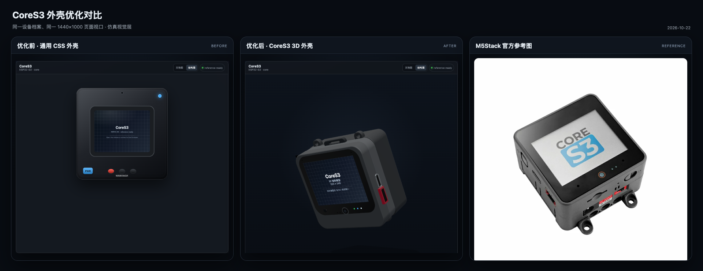

# CoreS3 three.js renderer

Date: `2026-10-22`

Status: `INTEGRATED — simulation-only visual shell`

CoreS3 now has a dedicated three.js shell built with the device-authoring
workflow from `MarsTechHAN/sticks3.js` `BUILD.md`. The renderer is isolated to
CoreS3; other remaining devices continue to use `M5DeviceShell`.

## Official references

- Product page: <https://docs.m5stack.com/en/core/CoreS3>
- Product hero: M5Stack `K128_main_pictures_01.jpg`
- Front reference:
  `static-cdn.m5stack.com/resource/docs/products/core/CoreS3/img-2f6b5728-af80-4934-854f-4771a7fe859e.webp`
- Back, side and DinBase references from the same official product gallery
- Dimension drawing and DXF linked from the product page "Model Size" section
- M5GFX panel selection:
  <https://github.com/m5stack/M5GFX/blob/master/src/M5GFX.cpp>

## Geometry

- CoreS3 module body: `54 × 54 × 15.5 mm`.
- Official hero configuration includes a DinBase: approximately `62 mm`
  overall height with four mounting ears and about `31.5 mm` total depth.
- LCD: natively `320 × 240`, ILI9342C or ILI9342E, landscape in the default
  M5GFX rotation.
- Active LCD size used by the model: `40.64 × 30.48 mm`, derived from the
  official 2.0-inch diagonal and 4:3 pixel geometry.
- Model origin is the core-module centre. `+X` is right, `+Y` is up and `+Z`
  faces the display.

The transparent glass, black bezel, camera, proximity sensor, microphone holes,
status lights, side power key, USB-C, M-Bus connector, Port.B/Port.C housings,
DinBase ears, rear mounting ring and screw heads are separate meshes.

## Runtime integration

- `CoreS3ThreeShell` extends the shared `ThreeDeviceShell`.
- RGB565 frames are written to the real `Display` component in the 3D model.
- The FT6336U touch surface emits project touch events and can inject QMP touch
  input from Live sessions.
- The side power key maps to the project's `power` control.
- WebGL or module-loading failure falls back to the original framebuffer view.

## Verification

- Headless UI checks cover the 3D renderer marker, red RGB565 pixel, frame
  sequence, power-button mapping and display touch events.
- A real reference CoreS3 QEMU session produced a live 320 × 240 frame and
  accepted `touch:100,107` from the rendered display.
- Desktop, tablet and mobile screenshots are captured as visual evidence.

## Boundary

This is a simulation visual model. It is not a CAD/STEP deliverable and does not
claim microscopic mechanical or material fidelity. No real-hardware comparison
was performed in this change.
