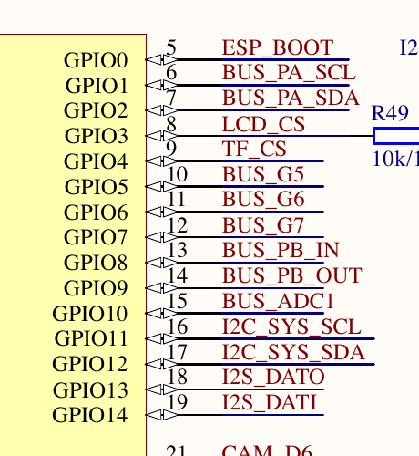
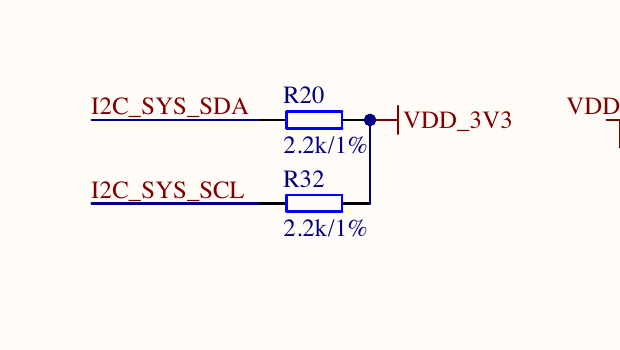

# CoreS3 系统 I2C 上拉：官方原理图与固定 M5GFX 源码

2026-10-27，只读研究归档。CoreS3 主板 v1.0 的 GPIO12/SDA 与 GPIO11/SCL 各有独立的 2.2kΩ、1% 电阻上拉到 `VDD_3V3`。这是电阻偏置的板级依据，不是常驻强驱动、实际电压测量或电气争用优先级证明。本目录没有运行 guest/API，也不授予整机或 Unit PASS。

## 原理图

[CoreS3 官方产品页](https://docs.m5stack.com/en/core/CoreS3) 的 **CoreS3 Schematics PDF** 直接链接到 [Sch_M5_CoreS3_v1.0.pdf](https://m5stack-doc.oss-cn-shenzhen.aliyuncs.com/490/Sch_M5_CoreS3_v1.0.pdf)。归档保留其 7 页原始字节，HTTP200、1,537,792 bytes，SHA256：

`58a15454eccb11d2668e1a9a3ad85943b9a58b104c5f1ed137b790192ec27c04`

证据位置是 **PDF 第 3 页（从 1 开始）**。该页 U5 ESP32-S3 与 B3 附近的两个电阻明确连接如下，均非 NC：

| GPIO / U5 pad | 网络 | 电阻 | 阻值 / 公差 | 上拉电源 |
| --- | --- | --- | --- | --- |
| GPIO12 / pad17 | I2C_SYS_SDA | R20 | 2.2kΩ / 1% | VDD_3V3 |
| GPIO11 / pad16 | I2C_SYS_SCL | R32 | 2.2kΩ / 1% | VDD_3V3 |

`schematic-page3.png` 是完整第 3 页，`schematic-page3-gpio.png` 和 `schematic-page3-pullups.png` 是直接由原 PDF 渲染的坐标裁图，未重绘线路；`schematic-page3-text.txt` 是同页完整提取原文。已视觉核对引脚、网络名、R20/R32、2.2k/1% 和 VDD_3V3。渲染器打印了 Fontconfig 配置警告，但输出成功，所需文字与连线清晰可读。

M5Stack 官方 MCP 的 `knowledge_search` 也返回了该 CoreS3 v1.0 图的 R20/R32 上拉索引；检索结果复用于 CoreS3-Lite、StackChan Core 等产品条目，因而本目录使用 **CoreS3 产品页直接链接的原始 PDF** 作为具体器件和网络的依据，不从相近产品名外推。

## 固定 M5GFX 路径

官方仓库提交为 `9bcedf4e19d4cab7a0793de0598ae5390b4689fe`。`M5GFX-official-fetch.json` 保留两个固定 raw GitHub URL、HTTP200、SHA 与生产者的 `git show` 字节匹配记录；本次归档再次逐字节 SHA 验证，原件分别保存为 `M5GFX.cpp.txt` 与 `esp32-common.cpp.txt`。

- [M5GFX.cpp](https://github.com/m5stack/M5GFX/blob/9bcedf4e19d4cab7a0793de0598ae5390b4689fe/src/M5GFX.cpp#L146)，SHA256 `4d1cf1345a6cb9477c371ce3a12fade45bb32f4e3fe53725a2a81ddb3588c997`。146-211 行的 `_detect_i2c_device` 先检查输出低，再分别用 `input_pulldown`、10us 等待和读回检测外部上拉；只有组合读值 `0x03` 才继续地址探测。585-586 行固定 SDA12/SCL11；1763-1775 行将此检测用于 CoreS3 分支。
- [ESP32 common.cpp](https://github.com/m5stack/M5GFX/blob/9bcedf4e19d4cab7a0793de0598ae5390b4689fe/src/lgfx/v1/platforms/esp32/common.cpp#L545)，SHA256 `f946662aaecf2b897e425d6293d232c712137517eb41e2973f94a5bc36d0b70b`。545-608 行保存/写入 IO_MUX，按模式设置内部 pull，明确使能 FUN_IE，并通过 open-drain/latch-high/ENABLE 配置输入与 GPIO route。完整条件编译分支保留在原件中，不把某一 IDF 分支外推到所有固件。

`M5GFX-excerpts.txt` 保存带原始行号的相关片段。所读固定源码证明该版本的驱动意图；**未取得这些字节与 stock 固件 BIN 的符号级对应，不声称已用它识别 stock 二进制内部函数**。本轮真实 guest 回归的串口、帧、执行和固件 SHA 由回归证据独立记录。

## 本轮修复边界与验证

该依据支持把真实 CoreS3 两条系统 I2C 上拉作为独立、可追溯的 board bias 接入控制器。内部 pull-down 与外部 pull-up 对抗时，未建立电气阈值/阻值求解的名义数字模型应保持 `unknown`；兼容读取值不能升级成已证明的物理高电平。不得用关闭 IE、把弱偏置伪装为 `set_input` 强驱动，或 getter/QOM 直接赋值来绕过板级布线。

本目录仅归档原理图/源码依据和视觉检查。原始 PDF、源码、提取文本、PNG、收据及本 README 均列入 `manifest.json`；`SHA256SUMS` 另包含该 manifest 的 SHA。可在本目录运行 `shasum -a 256 -c SHA256SUMS` 复核。没有 firmware/ROM 二进制、凭据或新 API/guest 执行；四主机 Flash/Torch/API/Web harness 保持 NOT RUN。
