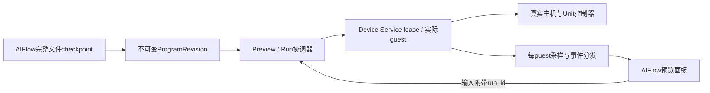

# AIFlow 实时编程与预览 API：评估与实施计划

日期：2026-10-26。归属 `UNIT-01`，模块边界与 `SVC-03` 协同。
状态：**评估完成，以下新接口与性能目标尚未实现/验收**。
生命周期修复已提交并完成限定验证，结果见
[取消与 Unit 回归](../evidence/2026-10-26-session-cancellation-f309/README.md)；
以下评估表描述固定旧基线，新 Preview/Revision/Run 接口仍未实现。
2026-10-26 补充核对 `99e3e22c`：生命周期修复已提交；本块结束后重新 fetch/merge
`origin/main@f2061759897955e6017d4aa2a41bd5ba962c35b6`，结果为 Already up to date。
执行优先级只维护在[项目Backlog](../project-backlog.md)，本页定义本任务的方案与门禁。

## 结论与当前证据

现API能支撑完整源码生成后的启动、交互和预览。要支撑AIFlow连续改代码、快速
反馈，应增加逻辑预览会话、不可变程序版本、可靠取消和统一实时分发，并缩短
每次准备Flash/启动的路径。现有真实guest、总线控制器、Unit数据面、source CAS、
不可变固件与Device Service lease/evidence继续复用。

本次只读评估仿真器 `0a6a9a2`，及AIFlow SDK最终 `b4994060`；后者审查期间HEAD
发生推进，受影响gateway及行引用已重新核对。没有变更API行为或AIFlow SDK，
没有部署。完整源码证据、host生命周期复现与计时来源见
[审查归档](../evidence/2026-10-26-aiflow-preview-api-audit/README.md)。

随后只读复核 AIFlow `947d182b` 及当时有并行未提交修改的工作树：新增设备数据
ingest/snapshot/SSE，可复用其订阅展示模式；它仍不是程序 checkpoint 或虚拟执行
target。`file_ready` 仍在 runner 返回后、task_completed 之前发送，下载读取当前
workspace；相关十文件前后哈希稳定。本观察不代表部署版本，详细收据见
[本块前端回归](../evidence/2026-10-26-preview-client-fencing/README.md)；没有读取运行配置或变更 AIFlow。

| 需求 | 当前实现 | 对实时编程的影响 |
| --- | --- | --- |
| 源码运行 | `/firmware/uiflow`把完整`.py`集合写入已知reference的LittleFS，再以source pin创建新session | 适合可复现运行；没有向同一guest上传/切换程序的接口 |
| 更新/取消 | session绑定固定固件；reset重启现有镜像，后台provision没有取消fence | 连续编辑缺少latest-wins；已复现stop之后后台仍launch/恢复running |
| 主机/Unit交互 | input、unit-input、QOM、真实帧/串口/设备态；Unit装配在创建时固定 | 能复用；运行中hotplug未实现，新装配需新执行实例 |
| 实时画面 | 页面目标125ms轮询，服务每请求QMP screendump→PPM→PNG，跨session await-all | 不是保证8FPS的帧流；多个观察者会重复采集/编码，慢请求影响刷新 |
| 实时状态/日志 | events为JSON读取，串口/设备态/Unit各自轮询 | 缺订阅、背压、断线游标和统一run/revision标签；现串口按offset返回但读全日志 |
| 资源文件 | source入口只接受`.py`文本，整体JSON受1MiB限制 | AIFlow生成图片/字体/音频等需额外受控asset manifest，不能当`.py`上传 |
| AIFlow消费者 | 有SSE/sequence恢复；file_ready在runner完成后整批发，下载读当前workspace | 可做任务结束后预览；持续预览还需中途checkpoint和不可变多文件快照 |
| AIFlow目标 | direct-run/server部署接物理DevicePusher；当前身份/部分配额依赖物理设备 | 虚拟预览需独立执行目标，不能误用物理push或伪造真机MAC |

24个已完成的三主机source IO会话，其原ZIP timeline给出：

| 主机，每款8例 | 创建→探针READY中位数 | 观察范围 |
| --- | ---: | ---: |
| AtomS3R | 14.91秒 | 14.43–15.31秒 |
| StickS3 | 16.98秒 | 16.71–17.32秒 |
| StopWatch | 20.65秒 | 20.48–21.34秒 |

全部24例创建→READY中位16.98秒；创建→booting为12.07–18.82秒，booting→running
为1.98–2.84秒，transport均为`esp-emu-esptool`。这说明该批主要成本是Flash准备，
与guest启动应分别优化。它包含具体探针初始化，**不是首帧、AIFlow全链路或SLA**。
同程序SHA缓存不能解决每次源码内容变化后的冷准备成本。

## 建议的资源与调用关系

`Preview`是AIFlow项目的稳定逻辑资源；`ProgramRevision`是完整不可变文件/资源
快照；`Run`绑定一次确定的源码、装配与实际Device Service执行实例。首版Run
可以创建新guest；未来通过已验证的传输在同guest重新执行时，也生成新Run，保留
真实的执行方式和来源。现有session的固件/evidence身份不被静默覆盖。

以下仅为拟定契约，不能按现有API调用：

| 拟定接口 | 责任 |
| --- | --- |
| `POST /api/v1/previews` | 建立逻辑preview，固定设备、runtime/profile及Unit装配版本；响应能力和执行方式 |
| `POST /api/v1/program-revisions` | 提交完整源码/asset manifest或CAS引用；只上传变化blob，但revision必须代表完整快照 |
| `POST /api/v1/previews/{id}/runs` | 以revision启动，带client_generation、expected_generation及Idempotency-Key，返回202/run_id |
| `POST /api/v1/previews/{id}/runs/{run_id}/cancel` | 取消指定运行；有界回收，未确认回收时为cancelling，完成后禁止复活 |
| `GET /api/v1/previews/{id}` / `GET /api/v1/previews/{id}/runs/{run_id}` | 读取desired/active运行、实际状态与事件游标，供初次加载或事件缺口后resync |
| `GET /api/v1/previews/{id}/events` | SSE状态/日志/Unit变化/frame_available，支持游标恢复与缺口resync |
| `GET /api/v1/previews/{id}/frame` | 返回生产者缓存的最新帧；ETag/304、frame_seq、run_id、revision_id、captured_at |
| `POST /api/v1/previews/{id}/input` | 转发真实guest/Unit输入，校验expected_run_id及控制权，拒绝过期操作 |
| `POST /api/v1/previews/{id}/renew` | 认证 owner 显式续租，受服务端最大租期/配额限制，响应新的 expires_at |
| `POST /api/v1/previews/{id}/close` | 停止接收新运行并有界取消当前事务，保留运行/evidence历史；回收未完成时返回closing |

建议第一版保留REST控制与SSE事件。SSE只发帧序号/URL/摘要，图片走条件GET；
后台每guest只采一次、按订阅者复用。需要更高帧率/摄像头时再基于实测增加二进制
帧通道，不能把PNG塞成无界base64 SSE。现有 `/sessions`、source pin和evidence
接口保持兼容，新预览层单独编排，避免一次拆写整个DeviceService。

首版更换设备、runtime/profile或Unit接线时创建新preview和执行实例，前端可在
同一项目预览窗口切换资源；不把配置更新称为运行中hotplug。preview协调器拥有
底层session lease，显式关闭、owner lease到期或idle回收走相同取消路径；只读
SSE/帧订阅不自动无限续租。具体租期、续租及保留配额在实施契约中明确，浏览器
断开不等于立即删除历史，也不能让遗留guest永久占用资源。

## 首版实施边界与接口细则

第一版交付定义为**完整代码保存后预览**：一次完整 checkpoint 对应一个不可变
Revision，以新 guest 执行；可连续提交、取消和交互。逐 token 执行、运行中 Unit
hotplug、同 guest 热部署及任意二进制资源不纳入首版已支持范围。Revision 显式
声明 `source_kind=uiflow2-python`；只接收当前 composer 验证过的完整 `.py` 集合，
不支持的资源类型返回明确错误。接口返回 `execution_mode=new-session` 和实际
能力，不让调用者根据资源名推断热部署能力。后续 asset blob/manifest 保持独立
扩展点。

首版应把预览编排放在独立模块，通过 DeviceService 现有方法管理执行；保持
`/sessions`、固件元数据、source pin、历史恢复与 evidence 契约兼容。先完成下列
身份与状态规则，再引入缓存采样/事件分发；不要在这一步整体拆写 runtime。

| 边界 | 必须确定的行为 |
| --- | --- |
| Revision 与固件 | Revision 以完整规范化 source/asset manifest、entrypoint、source_kind 及声明的兼容性生成独立 ID。Run 另行冻结 base SHA、设备/profile、版本化装配、初始 fixture 及构建 provenance；build/cache key 包含这些实际构建输入和工具链。固件 image SHA 只作为产物引用。当前 `FirmwareStore.create()` 会重写同 image SHA 的 metadata，不能直接充当不可变 Revision 数据库。现 source-pin mismatch 的 409 继续保留，禁止在失败后移除 pin 重试 |
| 提交与幂等 | `expected_generation` 对服务器 generation 做原子比较；客户端 generation 仅作关联。Run、generation 与幂等映射在同一 preview 事务中持久化后才返回 202。按 preview、认证 owner 和 Idempotency-Key 保存请求指纹与原 run 响应；相同 key/同指纹的重试先返回原 run，不因 generation 已前进而另起执行或提升 desired；同 key/不同内容返回 409 |
| 连续提交 | 每 preview 只保留一个待执行目标。新目标使旧启动失效，先取消旧 Run；旧 session 仍 stopping 时继续占容量，新目标处于等待清理状态，不为抢首帧提前释放租约或超额启动。desired Run 与正在退出的 active Run 分列 |
| 输入与切换 | 输入必须携带 `expected_run_id`；验证与取得该 Run 的输入执行权属于同一 admission 事务。切换后排队的旧输入返回 409，不能在检查后改向新 guest；耗时 QMP 不占全局 service 锁。切换释放 momentary 输入，保留 fixture 另作显式配置 |
| 帧身份 | `frame_available` 指向 Run/帧序号确定的 URL，例如 `/previews/{id}/runs/{run_id}/frames/{frame_seq}.png`。latest 快捷入口需 expected_run_id，并返回 run/revision/seq；ETag 同时包含身份与内容 SHA，不能只对像素哈希做 304。已淘汰帧返回 410，禁止悄悄返回另一个 Run 的最新帧 |
| 事件恢复 | event ID 包含 stream epoch 与单调 seq；有界 replay，Last-Event-ID 过期、epoch 变化或游标无效时发明确 resync。权威 GET 在同一 hub 锁内取得状态及游标，再从该 cursor 订阅，避免 GET 与订阅间漏事件。帧通知可合并，生命周期与日志缺口需可识别；不能用空列表表示断线后的完整历史 |
| 服务重启 | 持久化 preview 配置、Revision、run/session 绑定、generation 和幂等记录。冻结底层 session 请求，并用稳定 Run 派生的 session idempotency key 恢复创建中断窗口；重启先经 DeviceService ownership 校验接管或标 interrupted，不自动重跑未知执行。事件 epoch 更新，浏览器清掉旧缓存并 resync |
| 资源归属 | preview 的 control/renew/close 走认证 owner 范围，持久化绝对 expires_at；租期、空闲回收、最大待处理源码量、Run/帧/日志保留均有配置上限并在创建响应中公开。只读 GET/SSE 不续租，过期取消和显式 close 复用同一清理路径；不存在租约的 preview 不后台无限重建 guest |
| 引用与回收 | queued、active、cancelling 及保留 Run 都 pin 对应 Revision、源码 CAS、base 与派生固件。现固件 prune 仅按 session 引用保留，新增 Revision 时必须扩展根集合；过期幂等记录保留 tombstone 或明确返回已过期，不让一次旧请求在 GC 后被当成新执行 |

客户端也需要独立 fence：请求发出时固定 session/run、输入 epoch 和请求顺序，
在 `json()`/`blob()`/图片 decode 完成后重新检查，再更新 DOM、模型、声音或错误
状态。服务端携带标签不能替代这个检查；AbortController 也不能代替结果校验。
Unit GET 在输入 POST 之前发出、却在 POST 确认之后到达时，旧全量快照应丢弃，
由下一次真实读回恢复，不能用本地输入值补成控制器输出。

## 版本、取消和状态规则

- AIFlow的`task_id/task_seq`与运行的`run_id/preview_seq`分别维护，使用generation
  与revision关联。只有完整文件快照触发执行；assistant delta、截断/脱敏tool参数
  仅用于生成展示，不用于执行。
- 快照绑定base SHA、完整文件/asset hash、设备/profile、装配与fixture版本。
  单个资源更新不能让guest读取到跨版本混合文件；每次运行可独立取证。
- 每个preview单写者、单个启动事务；新generation使旧启动失效。每个耗时阶段
  返回后都检查取消/fence，进程创建与handle发布必须和stop使用相同生命周期锁。
- 不在全局service锁内等待Flash、QMP或peer；不要破坏现有QMP连接归属锁序。
  停止只回收该Run拥有的进程、Flash和companion，重复取消幂等，普通错误仍failed。
- 新旧run所有帧/日志/Unit事件都有run/revision/seq；前端丢弃旧版本到达的结果。
  ready marker必须属于本run的新串口窗口，不能重复消费历史READY。
- runtime 存活、application ready、首帧和首个应用效果帧分列；没有本 Run 的
  应用 readiness 条件时保持 unknown，不把 boot logo 或进程 running 算成代码
  已显示。性能基准使用已知探针的明确 UI 标记，不能从任意非空帧推断。
- 逻辑preview可以保留温度等用户fixture配置；按键等momentary输入在run转换时
  释放。输出状态始终来自当前guest控制器，不从旧run/Python变量伪造。
- 同run标记不等于帧/串口/Unit原子采样；每频道保留实际captured_at。slow client
  只保留最新帧，日志/关键生命周期采用有界replay与明确gap，不能无界排队。
- 串口增量读取使用seek/tail或单生产者；UTF-8分片需增量decoder或原字节协议，
  不能在每个任意byte边界replace解码后永久丢失中文字符。

## 分阶段实施与验收

### 先修生命周期正确性

已确定性复现：prepare_flash被Event阻塞时stop先返回stopped；释放后实际
_provision继续调用一次mock launch，变running且重新创建Flash。测试只mock
host调度/资源，不执行QEMU/guest/API，不提供外设测量。

修复覆盖prepare、资源发布、Popen/handle发布、QMP/readiness和重试边界；取消
独立退出，terminal不回到booting/running。普通qemu、radio/companion、Tab5与
network子类分别列覆盖，不能用一个分支通过代表全后端。验收包括重复stop、
失败回收、lease归零、取消后零新进程/可变Flash；超时不得提前承诺stopped。

本块已增加各会话生命周期事务、单调取消、停止意图版本与自动收尾，Tab5 reset、
Network runner child 收据、重附着 identity、draining/在途 janitor 均纳入同一
资源所有权边界。真实 8787 AtomS3R 源码准备取消与随后新 guest 的 PIR 交互已
通过；其它后端同场景实际执行与低延迟基准不继承宿主 mock 回归。

### 先形成可用的保存后预览

复用原source-CAS/新session作为第一执行adapter，加稳定Preview/Run、generation
和单飞取消。AIFlow首批可用`deploy_mode=none`在成功且文件完整后触发预览；
其当前物理身份约束仍须如实处理，不能宣称已经支持纯虚拟用户。

已有`M5_SERVICE_FLASH_MODE=host-image`与radio complete-image入口可研究为快速
准备路径：仅对已验证的完整UIFlow source image显式准入，保留chip/partition/
security/source SHA校验，和串口烧录验证类别分开。不要全局改变任意固件的验证
策略。本次尚未测量该模式，不能用静态路径推断优化后的实际秒数。

为多订阅者增加每guest FrameProducer和EventHub、缓存帧/ETag、请求超时与可见性
节流；控制输入不被慢客户端采集占用。验收实测完整编辑→第一张新版本帧、输入
→guest→反馈、丢弃旧帧、断线恢复、慢消费者内存、同设备多客户端与并发容量。

### 再做同guest快速重跑

需新增实际双向guest传输。当前UART主要file-backed输出且serial API只读，
不能直接当作现成raw REPL。对固定已知UIFlow2 reference验证：中断旧程序→
原子写入完整文件/资源→guest实际读回→执行→本run READY。VM/模块/定时器/IRQ
清理与状态保留规则明确；native阻塞/IRQ关闭等无法中断时有界降级到新guest。
不直接修改运行中的Flash，不在host执行caller Python。

独立 WASM 页的 `window.m5emu.execPython` 不能作为 Device Service 已具备传输的
依据；其延迟 UART 回调还缺 worker/epoch fence，静态风险记为 `UNIT-HOST-26`，
现场复现与修复另验。

预热限明确owner/profile，复用或snapshot必须另验Flash/eFuse/控制器/Unit状态
恢复；当前不存在已证明的通用savevm/跨租户池语义。建议以低秒级可感知反馈为
优化目标，冷/热、payload和设备分别给P50/P95；具体门槛以基准结果和产品体验
确认，当前不承诺2秒或8FPS SLA。

### AIFlow接入与生产边界

AIFlow补完整多文件/asset checkpoint事件和不可变artifact snapshot，下载按revision
而非当前workspace；具备可取消的virtual preview target/worker。复用其SSE恢复
机制，但任务与运行双事件流分别归属。资源失败、取消、续编及部分文件不能错配。

浏览器通过同源AIFlow后端代理持有授权，不把全局Device Service control token给
多个用户。preview/run/source/stream需要owner范围和配额，物理设备额度规则另行
明确，不能伪造MAC绕过。远程worker、隔离和资源上限按现有PILOT/NET-04边界
继续处理。本次未变更账户、计费、部署、物理设备或外部消息。
