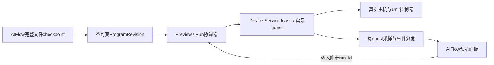

# AIFlow 实时编程与预览 API：评估与实施计划

日期：2026-10-26。归属 `UNIT-01`，模块边界与 `SVC-03` 协同。
状态：历史评估与实施过程，以下“当前”均指2026-10-26对应观察时点。
后续Preview/Run及Web协调、条件main.mpy公共入口已有分块验收，见
[当前状态](../project-status.md)、[公共入口结果](https://github.com/m5agent/m5stack-esp-emulator/blob/a37342f61c05964c060719a6e35c2d568c828e84/docs/evidence/2026-10-27-public-main-mpy/README.md)。
SSE、AIFlow调用侧和性能SLA仍开放，以Backlog为唯一执行队列。
生命周期修复已提交并完成限定验证，结果见
[取消与 Unit 回归](https://github.com/m5agent/m5stack-esp-emulator/blob/a37342f61c05964c060719a6e35c2d568c828e84/docs/evidence/2026-10-26-session-cancellation-f309/README.md)；
该结果与下述同 guest 程序执行属于不同验证范围。
2026-10-26 补充核对 `99e3e22c`：生命周期修复已提交；本块结束后重新 fetch/merge
`origin/main@f2061759897955e6017d4aa2a41bd5ba962c35b6`，结果为 Already up to date。
执行优先级只维护在[项目Backlog](../project-backlog.md)，本页定义本任务的方案与门禁。

## 当前工作块：同 guest 文件快照与资源

保留单文件 `source` 请求及其哈希语义，新增独立、不可变的完整文件包：
`main.py`、Python 模块、纯字节码 `.mpy` 依赖及资源文件。所有文件通过现有
guest UART raw REPL 写入隔离的暂存目录，逐文件读回大小与 SHA256，验证完整后
再发布目录、切换工作目录和导入路径；不重组固件、不重启 VM。失败和取消不能
把部分包标为已激活。guest 复用的文件仍需重验，不能信任上次部署后的可变目录。

本块已以四款准入主机×PIR/Relay真实guest验证跨文件导入、`.mpy`原生导入与资源读取、
A/B 模块缓存替换、同 PID/固件/VM、Unit 输入输出、异常恢复与停止前 evidence。
宿主测试只验证存储、协议、边界和取消，不替代 guest 文件系统或执行结果。
仅清除托管目录来源的 Python 模块；native、IRQ、timer 和 thread 的完整清场
仍未实现。`.mpy` 的版本与 small-int 限制由该 session 的 guest 能力决定，首版
明确拒绝 native emitter；二进制 `main.mpy` 的入口语义另行实现，不伪装成 `.py`。

限定结果已通过，见[文件包与detent证据](https://github.com/m5agent/m5stack-esp-emulator/blob/a37342f61c05964c060719a6e35c2d568c828e84/docs/evidence/2026-10-26-live-package-and-detent/README.md)。
图片文件路径接口保留UNIT-HOST-30 OPEN，实际资源读取后用官方bytes接口显示。

## 前置基线：直接创建与 Web 连续运行

在已有同 guest UART 路径上，增加显式 `program_mode=uiflow-live` 创建入口：
仅从已准入 reference 初始化一次 UART boot，拒绝与上传固件/source pin 混用，
继承原请求幂等键和 lease。Web 在同一 session 内编辑完整源码并运行，执行
状态、帧和 Unit 均来自真实 guest；请求晚到不能跨 owner 改写面板或编辑内容。
用 CoreS3、AtomS3R、StickS3、StopWatch 的 PIR 输入与 Relay 输出验证：同固件/
PID/VM、程序替换、源码异常恢复、控制器读回和停止前 evidence。逐主机分别
记录，不用已有 AtomS3R 结果替代新验证。外壳同步并行核对固定公开提交和 PNG/
ESM 资源闭包，新视觉 Unit 不自动获得内部协议实现状态。本块的限定结果已通过，
见[直接创建与 Web 验证](https://github.com/m5agent/m5stack-esp-emulator/blob/a37342f61c05964c060719a6e35c2d568c828e84/docs/evidence/2026-10-26-live-program-web-and-hosts/README.md)和
[外壳更新](https://github.com/m5agent/m5stack-esp-emulator/blob/a37342f61c05964c060719a6e35c2d568c828e84/docs/evidence/2026-10-26-visual-refresh-48667b7/README.md)；Preview/SSE 协调层仍待实现。

## 结论与当前证据

UIFlow 连续改代码的当前主路径是：首次准备并启动具备 UART REPL 路由的 session，
随后通过 `POST /api/v1/sessions/{id}/program` 在同一 guest 的 MicroPython VM 中
下发、编译和执行完整源码 checkpoint，通过对应 GET 查询执行状态。每次源码
更新不再要求重组 Flash 或创建新 guest。原 `/firmware/uiflow` composer 与新
session 路径保留为初始化、兼容运行及显式重建入口。

`.py`在guest内实时编译执行；完整包的纯字节码`.mpy`模块也由真实guest importer加载。
这两条路径都不会为每次编辑重刷固件；当前入口限定`main.py`，直接`main.mpy`仍待实现。
`GET /devices`新增`program_features`，明确`main.py`、纯字节码依赖、fresh exec globals
及interrupt-only边界，不授予任意上传固件UART兼容性。固定UIFlow/MicroPython源码与
真实CoreS3 probe确认：当前固件未开启`MICROPY_MODULE_OVERRIDE_MAIN_IMPORT`，
普通`.mpy`导入保留模块名，if-main不运行；`__main__.mpy`别名也被REPL内置module遮蔽。
新入口需官方配置的新固件或受验loader路径，且定义加载失败与START边界；不以改`__name__`
替代完整执行。源脚本的新globals也不替换`sys.modules['__main__']`，见
[入口研究与能力契约](https://github.com/m5agent/m5stack-esp-emulator/blob/a37342f61c05964c060719a6e35c2d568c828e84/docs/evidence/2026-10-26-uniform-led-and-program-capabilities/README.md)。
Scroll补充四主机原驱动连续程序及CoreS3 Web按键/RGB/屏幕证据，见
[限定控制器工作块](https://github.com/m5agent/m5stack-esp-emulator/blob/a37342f61c05964c060719a6e35c2d568c828e84/docs/evidence/2026-10-26-scroll-controller/README.md)。本块同时暴露全局
source revision配额耗尽：现可显式配置1..4096、默认256并保持旧记录，长期的引用保留/
有界回收仍需实现，不将增大本地测试容量称为实时服务生命周期完成。

现有真实 guest、总线控制器、Unit 数据面、固件身份与 Device Service lease/evidence
继续复用；每次程序执行另有 `execution_id`、`revision_id` 和源码哈希。逻辑
Preview/Run 编排、统一实时事件与后台订阅采样仍待实现；当前增加独立按需共享帧
缓存，不从同 guest 或该缓存推断 AIFlow 已接入这些能力。

当前实际 guest 验证覆盖 **CoreS3、AtomS3R、StickS3、StopWatch 各自的 PIR/Relay**，
8组合、40次程序，均由直接模式创建。CoreS3 另有真实网页两例，验证程序 A/B 替换、
PIR 输入、Relay 输出、实际 guest PNG 像素进入模型 display、语法错误及恢复。
见[直接创建与 Web 证据](https://github.com/m5agent/m5stack-esp-emulator/blob/a37342f61c05964c060719a6e35c2d568c828e84/docs/evidence/2026-10-26-live-program-web-and-hosts/README.md)：
同一 guest 的 PID/固件/VM nonce、新鲜串口窗口、不同应用帧和停止前 ZIP 分别记录。
早期手动 bootstrap 的 AtomS3R 基线仍见
[首轮实时程序验证](https://github.com/m5agent/m5stack-esp-emulator/blob/a37342f61c05964c060719a6e35c2d568c828e84/docs/evidence/2026-10-26-uiflow-live-program/README.md)。
虚拟执行不代表物理硬件验证；提交确认时间是单机小样本，不代表首帧或 SLA。

早期只读评估使用仿真器 `0a6a9a2`，及AIFlow SDK最终 `b4994060`；后者审查期间
HEAD 发生推进，受影响 gateway 及行引用已重新核对。该次评估没有变更 API 行为
或 AIFlow SDK，没有部署。其完整源码证据、host 生命周期复现与计时来源见
[审查归档](https://github.com/m5agent/m5stack-esp-emulator/blob/a37342f61c05964c060719a6e35c2d568c828e84/docs/evidence/2026-10-26-aiflow-preview-api-audit/README.md)。

随后只读复核 AIFlow `947d182b` 及当时有并行未提交修改的工作树：新增设备数据
ingest/snapshot/SSE，可复用其订阅展示模式；它仍不是程序 checkpoint 或虚拟执行
target。`file_ready` 仍在 runner 返回后、task_completed 之前发送，下载读取当前
workspace；相关十文件前后哈希稳定。本观察不代表部署版本，详细收据见
[本块前端回归](https://github.com/m5agent/m5stack-esp-emulator/blob/a37342f61c05964c060719a6e35c2d568c828e84/docs/evidence/2026-10-26-preview-client-fencing/README.md)；没有读取运行配置或变更 AIFlow。

下表描述当前仿真器实现；AIFlow 侧两行沿用上述日期的只读观察，不代表其部署状态。

| 需求 | 当前实现 | 对实时编程的影响 |
| --- | --- | --- |
| 源码运行 | opt-in session 的 `/program` 通过实际 UART raw REPL 在同一 guest 中编译执行单个完整源码 checkpoint | 当前主路径；四主机PIR/Relay分别验证，以 execution/revision 身份关联观测，其它Unit仍逐例验证 |
| 初始化与兼容 | `program_mode=uiflow-live`一次初始化已准入reference；`/firmware/uiflow`保留完整`.py`集合手动准备入口 | 用于首次 UART 路由准备、完整文件初始化与兼容运行；每次编辑只需提交源码 |
| 更新/取消 | `/program` 使用 `expected_execution_id` 和单个传输 owner；session 生命周期已有取消 fence | 可拒绝过期/并发提交；旧程序中断需 raw REPL 同步确认，尚无 Preview latest-wins 编排 |
| 主机/Unit交互 | input、unit-input、QOM、真实帧/串口/设备态；Unit装配在创建时固定 | 能复用；运行中hotplug未实现，新装配需新执行实例 |
| 实时画面 | 默认GET仍直采；QEMU显式max_age_ms复用同session样本/在途采集，ETag/304；网页每visual独立有界请求 | 减少重复采集和慢session阻塞；采集元数据不证明应用ready，不保证8FPS或端到端SLA |
| 实时状态/日志 | events为JSON读取，串口/设备态/Unit各自轮询；串口按offset seek后只读请求窗口 | 缺订阅、背压、断线游标和统一run/revision标签；任意byte切片仍使用replace解码 |
| 资源文件 | `/program` 保留64KiB `source`，并新增完整 `files` 包；guest UART真实写入、哈希读回与托管模块切换 | 同guest多文件/纯字节码`.mpy`依赖和资源；总decoded 1MiB/64文件，原生emitter及开机保存不准入 |
| AIFlow消费者 | 有SSE/sequence恢复；file_ready在runner完成后整批发，下载读当前workspace | 可做任务结束后预览；持续预览还需中途checkpoint和不可变多文件快照 |
| AIFlow目标 | direct-run/server部署接物理DevicePusher；当前身份/部分配额依赖物理设备 | 虚拟预览需独立执行目标，不能误用物理push或伪造真机MAC |

以下为**旧 composer/新 session 路径**的历史计时；24个已完成的三主机 source IO
会话，其原 ZIP timeline 给出：

| 主机，每款8例 | 创建→探针READY中位数 | 观察范围 |
| --- | ---: | ---: |
| AtomS3R | 14.91秒 | 14.43–15.31秒 |
| StickS3 | 16.98秒 | 16.71–17.32秒 |
| StopWatch | 20.65秒 | 20.48–21.34秒 |

全部24例创建→READY中位16.98秒；创建→booting为12.07–18.82秒，booting→running
为1.98–2.84秒，transport均为`esp-emu-esptool`。这说明该批主要成本是Flash准备，
与 guest 启动应分别观察。它包含具体探针初始化，**不是当前同 guest 下发耗时、
首帧、AIFlow全链路或SLA**，不能用于推算新路径的提速比例。同程序 SHA 缓存也
不能解决旧路径每次源码内容变化后的冷准备成本。

## 当前同 guest 接口与使用边界

推荐创建 session 时指定 `program_mode="uiflow-live"`，自动安装一次 guest UART
路由并选择传输；手动初始化的兼容入口指定 `program_transport="uart-repl"`。当前只准入
`runtime="qemu"` 的 CoreS3、AtomS3R、StickS3、StopWatch UIFlow2 reference 或
已绑定 source pin 的 UIFlow composer 固件；普通 session 的 file-backed 串口行为
保持原样。准入名单与逐设备验证结果分开维护。

首次初始化必须让 guest 的 `boot.py` 安装适配该固件的 UART REPL 路由，例如
UART0、`os.dupterm` 及相应 RX IRQ 通知，并避免启动菜单占据执行路径；已有原生
UART REPL 的固件需使用其实际路由。`program_transport` 只配置宿主传输，不能
替代 guest 端路由，也不意味着任意 stock reference 已可接收代码。具体调用说明
见 [Unit Agent API](../unit-agent-api.md)。

| 当前接口 | 行为 |
| --- | --- |
| `POST /api/v1/sessions/{id}/program` | 互斥接收 `source` 或完整 `files`，附 `expected_execution_id` 和可选 `timeout_seconds`，经同一guest UART传输与执行 |
| `GET /api/v1/sessions/{id}/program` | 返回 session 的程序传输、当前 execution/revision 身份及观测状态；不是 SSE 订阅 |

`source` 必须是有效 UTF-8 字符串，编码后至多65536字节；完整文件改用 `files`，
细节见[Agent指南](../unit-agent-api.md#同一-vm-的完整文件包)。首次 `expected_execution_id` 为 `null`，后续使用查询得到的
当前执行 ID；过期 ID 和并发传输返回 409。`timeout_seconds` 为 1–30 秒，默认
10秒；`files`为1–120秒/默认120秒。预算约束部署与开始确认，不限制程序运行时长。接口继承
现有 Bearer 授权规则。

执行记录声明 `execution_mode="same-guest-uart-repl"` 和
`cleanup_mode="interrupt-only"`。START 表示 guest 已完成编译并进入执行，DONE
或 ERROR 反映包装执行的结束；START 不代表应用 READY、画面完成或功能通过。
确认超时保留 `unknown` 和执行 ID，调用方应查询后续状态，不能把超时当成代码
未执行而盲目重试。停止与替换的记录也必须区分中断请求和实际同步确认。

该路径不重启VM、不重组Flash；`source`在内存执行，`files`写入专用guest目录。
托管包替换会清理其来源模块及namespace，完整文件和目录在复用时仍重验；
native、timer、IRQ、其它thread和外设状态仍可能存在。单源码引用初始化文件，
完整包也不保证native资源原子切换。无法中断或路由失效时应保留明确失败/
未确认状态，由调用方显式选择兼容的新 session 路径，不能暗中切换执行实例。

## 早期 Preview 资源与调用关系（由1.42实施契约接替）

`Preview`是AIFlow项目的稳定逻辑资源；`ProgramRevision`是完整不可变文件/资源
快照；`Run`绑定一次确定的源码、装配与实际 Device Service 执行实例。这是后续
编排模型：同 guest 执行应复用当前 `/program` 主路径，每次执行仍保留独立身份；
新 guest 是初始化、兼容或配置变化时的另一执行方式。当前已有公共完整package
checkpoint保存/查询、同步revision引用执行和session程序记录，不能将其等同于已实现 Preview/Run HTTP 资源。现有
session 的固件/evidence 身份不被静默覆盖。

以下Preview/Run接口仍为后续拟定契约，不能按现有API调用。公共
`POST /api/v1/program-revisions`与对应GET已实现，首版接收完整文件包；
仅上传变化blob的CAS/manifest扩展仍未实现：

| 拟定接口 | 责任 |
| --- | --- |
| `POST /api/v1/previews` | 建立逻辑preview，固定设备、runtime/profile及Unit装配版本；响应能力和执行方式 |
| `POST /api/v1/program-revisions`（已实现，扩展待做） | 当前提交完整文件包，返回不可变revision；未来CAS增量上传仍须得到完整快照 |
| `POST /api/v1/previews/{id}/runs` | 以revision启动，带client_generation、expected_generation及Idempotency-Key，返回202/run_id |
| `POST /api/v1/previews/{id}/runs/{run_id}/cancel` | 取消指定运行；有界回收，未确认回收时为cancelling，完成后禁止复活 |
| `GET /api/v1/previews/{id}` / `GET /api/v1/previews/{id}/runs/{run_id}` | 读取desired/active运行、实际状态与事件游标，供初次加载或事件缺口后resync |
| `GET /api/v1/previews/{id}/events` | SSE状态/日志/Unit变化/frame_available，支持游标恢复与缺口resync |
| `GET /api/v1/previews/{id}/frame` | 返回生产者缓存的最新帧；ETag/304、frame_seq、run_id、revision_id、captured_at |
| `POST /api/v1/previews/{id}/input` | 转发真实guest/Unit输入，校验expected_run_id及控制权，拒绝过期操作 |
| `POST /api/v1/previews/{id}/renew` | 认证 owner 显式续租，受服务端最大租期/配额限制，响应新的 expires_at |
| `POST /api/v1/previews/{id}/close` | 停止接收新运行并有界取消当前事务，保留运行/evidence历史；回收未完成时返回closing |

后续预览层计划保留 REST 控制并增加 SSE 事件。SSE 只发帧序号/URL/摘要，图片
走条件 GET；后台每guest只采一次、按订阅者复用。需要更高帧率/摄像头时再基于实测增加二进制
帧通道，不能把PNG塞成无界base64 SSE。现有 `/sessions`、source pin和evidence
接口保持兼容，新预览层单独编排，避免一次拆写整个DeviceService。

后续更换设备、runtime/profile或Unit接线时创建新preview和执行实例，前端可在
同一项目预览窗口切换资源；不把配置更新称为运行中hotplug。preview协调器拥有
底层session lease，显式关闭、owner lease到期或idle回收走相同取消路径；只读
SSE/帧订阅不自动无限续租。具体租期、续租及保留配额在实施契约中明确，浏览器
断开不等于立即删除历史，也不能让遗留guest永久占用资源。

## 当前交付与后续 Preview 层接口细则

当前交付定义为**完整源码 checkpoint 保存后，在已初始化的同一 guest 中执行**。
早期评估中“首版每次创建新 guest、同 guest 执行留待以后”的方案已由当前主路径
替代，不再作为实施要求。原 `uiflow2-python` 冻结单源码，新 `uiflow2-package`
冻结完整文件/资源集合，两个store及哈希语义独立；composer保留初始化用途。
逐token、运行中Unit hotplug、完整VM清理、native emitter及开机保存仍未支持。
公共Revision HTTP与同步引用执行已落地；CAS增量blob/manifest与Preview编排保持扩展点。

后续 Preview 编排应放在独立模块，通过 DeviceService 现有方法管理执行；保持
`/sessions`、固件元数据、source pin、历史恢复与 evidence 契约兼容。先完成下列
计划中的身份与状态规则，再引入缓存采样/事件分发；不要把这些未来字段写成
当前 `/program` 接口承诺，也不要在这一步整体拆写 runtime。

| 边界 | 必须确定的行为 |
| --- | --- |
| Revision 与固件 | Revision 以完整规范化 source/asset manifest、entrypoint、source_kind 及声明的兼容性生成独立 ID。Run 另行冻结 base SHA、设备/profile、版本化装配、初始 fixture 及构建 provenance；build/cache key 包含这些实际构建输入和工具链。固件 image SHA 只作为产物引用。当前 `FirmwareStore.create()` 会重写同 image SHA 的 metadata，不能直接充当不可变 Revision 数据库。现 source-pin mismatch 的 409 继续保留，禁止在失败后移除 pin 重试 |
| 提交与幂等 | `expected_generation` 对服务器 generation 做原子比较；客户端 generation 仅作关联。Run、generation 与幂等映射在同一 preview 事务中持久化后才返回 202。按 preview、认证 owner 和 Idempotency-Key 保存请求指纹与原 run 响应；相同 key/同指纹的重试先返回原 run，不因 generation 已前进而另起执行或提升 desired；同 key/不同内容返回 409 |
| 连续提交 | 每 preview 只保留一个待执行目标。新目标使旧启动失效，先取消旧 Run；旧 session 仍 stopping 时继续占容量，新目标处于等待清理状态，不为抢首帧提前释放租约或超额启动。desired Run 与正在退出的 active Run 分列 |
| 输入与切换 | 输入必须携带 `expected_run_id`；验证与取得该 Run 的输入执行权属于同一 admission 事务。切换后排队的旧输入返回 409，不能在检查后改向新 guest；耗时 QMP 不占全局 service 锁。切换释放 momentary 输入，保留 fixture 另作显式配置 |
| 帧身份 | `frame_available` 指向 Run/帧序号确定的 URL，例如 `/previews/{id}/runs/{run_id}/frames/{frame_seq}.png`。latest 快捷入口需 expected_run_id，并返回 run/revision/seq；ETag 同时包含身份与内容 SHA，不能只对像素哈希做 304。已淘汰帧返回 410，禁止悄悄返回另一个 Run 的最新帧 |
| 事件恢复 | event ID 包含 stream epoch 与单调 seq；有界 replay，Last-Event-ID 过期、epoch 变化或游标无效时发明确 resync。权威 GET 在同一 hub 锁内取得状态及游标，再从该 cursor 订阅，避免 GET 与订阅间漏事件。帧通知可合并，生命周期与日志缺口需可识别；不能用空列表表示断线后的完整历史 |
| 服务重启 | 持久化 preview 配置、Revision、run/session 绑定、generation 和幂等记录。冻结底层 session 请求，并用稳定 Run 派生的 session idempotency key 恢复创建中断窗口；重启先经 DeviceService ownership 校验接管或标 interrupted，不自动重跑未知执行。事件 epoch 更新，浏览器清掉旧缓存并 resync |
| 资源归属 | preview 的 control/renew/close 走认证 owner 范围，持久化绝对 expires_at；租期、空闲回收、最大待处理源码量、Run/帧/日志保留均有配置上限并在创建响应中公开。只读 GET/SSE 不续租，过期取消和显式 close 复用同一清理路径；不存在租约的 preview 不后台无限重建 guest |
| 引用与回收 | queued、active、cancelling 及保留 Run 都 pin 对应 Revision、源码 CAS、base 与派生固件。现固件 prune 仅按 session 引用保留，新增 Revision 时必须扩展根集合；过期幂等记录保留 tombstone 或明确返回已过期，不让一次旧请求在 GC 后被当成新执行 |

客户端也需要独立 fence：请求发出时固定 session/run、输入 epoch 和请求顺序，
在 `json()`/`blob()`/图片 decode 完成后重新检查，再更新 DOM、模型、声音或错误
状态。服务端携带标签不能替代这个检查；AbortController 也不能代替结果校验。
Unit GET 在输入 POST 之前发出、却在 POST 确认之后到达时，旧全量快照应丢弃，
由下一次真实读回恢复，不能用本地输入值补成控制器输出。

## 后续 Preview 层的版本、取消和状态规则

- AIFlow的`task_id/task_seq`与运行的`run_id/preview_seq`分别维护，使用generation
  与revision关联。只有完整文件快照触发执行；assistant delta、截断/脱敏tool参数
  仅用于生成展示，不用于执行。
- 快照绑定base SHA、完整文件/asset hash、设备/profile、装配与fixture版本。
  单个资源更新不能让guest读取到跨版本混合文件；每次运行可独立取证。
- 每个preview单写者、单个启动事务；新generation使旧启动失效。每个耗时阶段
  返回后都检查取消/fence，进程创建与handle发布必须和stop使用相同生命周期锁。
- 不在全局service锁内等待Flash、QMP或peer；不要破坏现有QMP连接归属锁序。
  停止只回收该Run拥有的进程、Flash和companion，重复取消幂等，普通错误仍failed。
- 新旧run所有帧/日志/Unit事件都有run/revision/seq；前端丢弃旧版本到达的结果。
  ready marker必须属于本run的新串口窗口，不能重复消费历史READY。
- runtime 存活、application ready、首帧和首个应用效果帧分列；没有本 Run 的
  应用 readiness 条件时保持 unknown，不把 boot logo 或进程 running 算成代码
  已显示。性能基准使用已知探针的明确 UI 标记，不能从任意非空帧推断。
- 逻辑preview可以保留温度等用户fixture配置；按键等momentary输入在run转换时
  释放。输出状态始终来自当前guest控制器，不从旧run/Python变量伪造。
- 同run标记不等于帧/串口/Unit原子采样；每频道保留实际captured_at。slow client
  只保留最新帧，日志/关键生命周期采用有界replay与明确gap，不能无界排队。
- 串口增量读取使用seek/tail或单生产者；UTF-8分片需增量decoder或原字节协议，
  不能在每个任意byte边界replace解码后永久丢失中文字符。

## 分阶段实施与验收

### 已完成的生命周期修复与独立门禁

早期已确定性复现：prepare_flash被Event阻塞时stop先返回stopped；释放后实际
_provision继续调用一次mock launch，变running且重新创建Flash。测试只mock
host调度/资源，不执行QEMU/guest/API，不提供外设测量。

修复覆盖prepare、资源发布、Popen/handle发布、QMP/readiness和重试边界；取消
独立退出，terminal不回到booting/running。普通qemu、radio/companion、Tab5与
network子类分别列覆盖，不能用一个分支通过代表全后端。验收包括重复stop、
失败回收、lease归零、取消后零新进程/可变Flash；超时不得提前承诺stopped。

此前已增加各会话生命周期事务、单调取消、停止意图版本与自动收尾，Tab5 reset、
Network runner child 收据、重附着 identity、draining/在途 janitor 均纳入同一
资源所有权边界。真实 8787 AtomS3R 源码准备取消与随后新 guest 的 PIR 交互已
通过；其它后端同场景实际执行与低延迟基准不继承宿主 mock 回归。

### 当前主路径：同 guest 保存后执行

当前通过独立 `guest_console.py` 原始字节传输与 `uiflow_runtime.py` raw REPL
执行适配，接到 Device Service 的 GET/POST `/program`。同一 session 内以执行
ID 防过期替换、单个传输 owner 防并发交错，观测和持久化仍归该 session。
AIFlow 消费端接入、稳定 Preview/Run 与 latest-wins 编排另做；其物理身份约束
仍须如实处理，不能宣称已经支持纯虚拟用户。

已有`M5_SERVICE_FLASH_MODE=host-image`与radio complete-image入口可研究为快速
准备路径：仅对已验证的完整UIFlow source image显式准入，保留chip/partition/
security/source SHA校验，和串口烧录验证类别分开。不要全局改变任意固件的验证
策略。本次尚未测量该模式，不能用静态路径推断优化后的实际秒数。

当前已补每session按需共享样本、缓存帧/ETag、单visual请求超时及owner/decode隔离，
见[多Unit与共享预览](https://github.com/m5agent/m5stack-esp-emulator/blob/a37342f61c05964c060719a6e35c2d568c828e84/docs/evidence/2026-10-26-live-unit-preview/README.md)。后台订阅
FrameProducer与EventHub仍待做；控制输入不应被慢客户端采集占用。后续实测完整编辑→第一张新版本帧、输入
→guest→反馈、丢弃旧帧、断线恢复、慢消费者内存、同设备多客户端与并发容量。

### 同 guest 路径的剩余验收与状态清理

实际双向 guest UART 传输与程序执行接口已新增；普通 session 的串口 API 仍为
只读日志，不能直接把任意 file-backed session 当成 raw REPL。当前主路径是
中断旧程序→确认raw REPL→传输源码或完整文件包→guest编译/执行标记；
文件包在真实guest文件系统校验发布，native资源切换并非原子。应用READY、替换、Unit反馈与证据
已在上述四主机PIR/Relay逐例绑定固件、源码和运行时验证；其它Unit、固件与运行方式
仍需各自验证，不能从本批继承同 guest 结论。

完整 VM/native 模块、timer、IRQ、thread 清理尚无通用保证；native 阻塞、IRQ
关闭或 caller 改写 UART/dupterm 时，不能承诺可靠中断或自动恢复。显式重建
guest 与在原 guest 中继续执行必须分别记载，不能拼接为同一执行成功。不直接
修改运行中的Flash镜像；包仅经guest文件系统写入，不在host执行caller Python。

独立 WASM 页的 `window.m5emu.execPython` 不能作为 Device Service 已具备传输的
依据；其延迟 UART 回调还缺 worker/epoch fence，静态风险记为 `UNIT-HOST-26`，
现场复现与修复另验。

预热限明确owner/profile，复用或snapshot必须另验Flash/eFuse/控制器/Unit状态
恢复；当前不存在已证明的通用savevm/跨租户池语义。建议以低秒级可感知反馈为
优化目标，冷/热、payload和设备分别给P50/P95；具体门槛以基准结果和产品体验
确认，当前不承诺2秒或8FPS SLA。

### AIFlow接入与生产边界

AIFlow补完整多文件/asset checkpoint事件和不可变artifact snapshot，下载按revision
而非当前workspace；具备可取消的virtual preview target/worker。复用其SSE恢复
机制，但任务与运行双事件流分别归属。资源失败、取消、续编及部分文件不能错配。

浏览器通过同源AIFlow后端代理持有授权，不把全局Device Service control token给
多个用户。preview/run/source/stream需要owner范围和配额，物理设备额度规则另行
明确，不能伪造MAC绕过。远程worker、隔离和资源上限按现有PILOT/NET-04边界
继续处理。本次未变更账户、计费、部署、物理设备或外部消息。

## 当前前置实施：公共完整checkpoint与引用执行

在同VM文件包路径之上，先提供公共不可变`uiflow2-package` checkpoint创建/元数据查询，以及既有同步`/sessions/{id}/program`的`revision_id`引用。其作用是让外部Agent把完整文件快照与实际执行分开，之后Preview/Run直接引用同一revision；不把旧/program改成假异步202，不假称已实现Preview协调器、latest-wins或保VM的Run取消。

公共入口只准完整package，复用当前规范化路径、文件/总字节和纯字节码检查；旧python source store/哈希保持原样，不能用旧多文件python revision只执行main代替完整checkpoint。source/files/revision_id必须互斥，引用请求也须expected_execution_id；坏ID、未知/损坏包、已知native/损坏bytecode或stale请求在执行分配前拒绝。guest实际版本/small-int不兼容仍可能在同步并中断旧程序后才发现，保留failed execution和收据。引用执行验证存储后直接复用包，不重新create revision。响应公开实际配额和gc_enabled=false，沿用现有服务Bearer授权，不信任body owner或声称多租户隔离。

验收包括真实HTTP/宿主故障负控、现有source/files兼容、引用不重创revision，以及8787可见session中同VM运行A/B多文件/纯字节码依赖和资源、实际Unit输入输出/帧/串口、旧请求拒绝与停止前取证。root另修serial_read按offset seek只读请求窗口，16MiB稀疏日志负控原版全量read失败，新版边界/历史/缺失行为通过；该优化不改变任意byte切片的replace解码，不冒称UTF8分片策略已解决。

该前置已通过CoreS3 PIR/Relay各自的新实际同VM引用运行和旧路径负控，见[checkpoint与复测证据](https://github.com/m5agent/m5stack-esp-emulator/blob/a37342f61c05964c060719a6e35c2d568c828e84/docs/evidence/2026-10-26-visual-refresh-and-checkpoints/README.md)。公共checkpoint/save-get和同步引用可按1.41契约调用。本页早期Preview/Run设计由[2026-10-27实施计划](2026-10-27-preview-run-control.md)和[1.42契约](../device-service-api.md#stable-preview-and-asynchronous-runs)接替，CoreS3 PIR/Relay限定独立验收已通过；Web托管消费者、SSE与AIFlow端接入仍开放。
