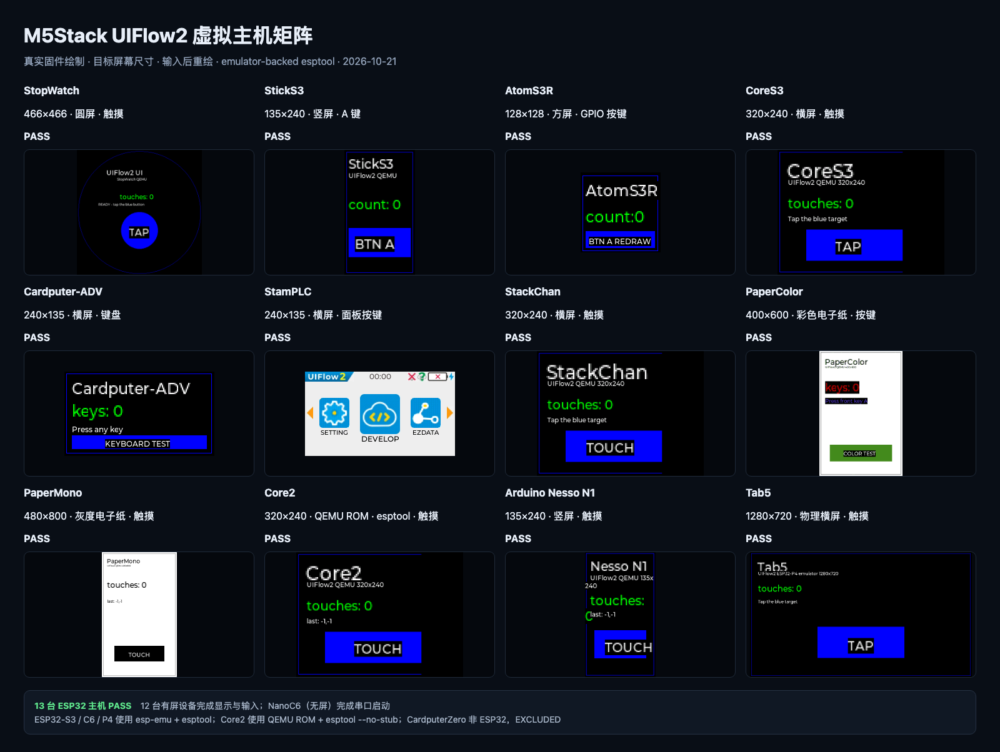
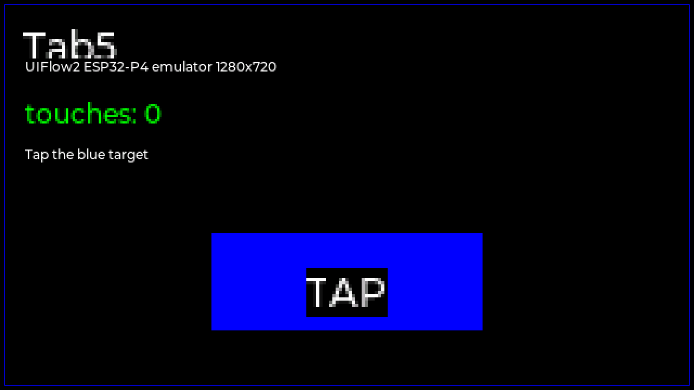
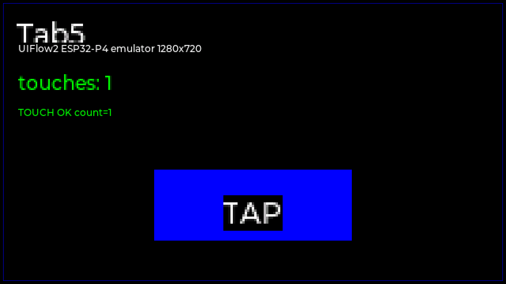

# 虚拟主机适配矩阵

日期：`2026-10-24`

本文记录 SoC、板级模型和测试工程的技术适配关系。当前可用能力、网络状态
和剩余风险以 [项目当前状态](project-status.md) 为准，未完成工作以
[项目 Backlog](project-backlog.md) 为准。

## 结论

可以适配，但不能给 14 台设备各写一套 QEMU。按 SoC/显示/输入分组后：

- **9 台 ESP32-S3** 共用一套 QEMU/S3 后端和 GPIO/SPI/I2C 框架，只补板级 profile、显示模型、输入和外设。
- **2 台 ESP32-C6** 需要 C6 后端/板级模型。
- **Tab5（ESP32-P4）** 使用 `esp-emu 0.50.0`、P4 rev0 ROM 和配套 eFuse，接入 C6 ESP-Hosted 协处理器，并以仿真 M5GFX DSI framebuffer 输出真实 UI。
- **Core2（ESP32 LX6）** 使用 QEMU `esp32`/`m5core2` machine，并通过 ROM UART 下载模式完成 `esptool` 虚拟烧录。可选 QEMU 补丁让 stock UIFlow2 完成 WiFi、受控 HTTP、公网 DNS/HTTP 和 controller advertising-enable。统一测试使用 `tcg,thread=single` + deterministic icount，10/10 次无重试首轮 PASS。BLE 有三层路径：可重建的 HCI-UART 固件经 UART1 连接 Bumble；legacy native-VHCI 通过 GDB 做边界诊断；规范的 `core2-native-hci` 使用 QEMU `esp32-native-hci`、`0003` API-boundary H2C、`0004` CCOUNT TB-yield、`0005` halt-gated guest call 和固件 HLI event/ACL 交付。`HCI-4` 五 lease、两批 `5×10s` `10/10`、3 个 `60s` `3/3` 和 2 个 `120s` `2/2` 均通过，前几组同包验证 frame/QOM/WiFi/公网/NUS GATT/pcap/evidence，后几组每轮 HLI health 为零错误，且全程 `gdb_bridge=false`。旧 notification timeout 已定位为 21-byte probe 超过默认 ATT MTU，不是 controller 缺陷。之后才是多小时 soak、同 guest 重连、bit-exact controller/baseband、物理 cache/PSRAM、coexistence 和真机同路径。
- **CardputerZero** 是 Linux ARM64（BCM2837），不是 ESP32 固件目标；独立
  QEMU Linux 后端已可启动官方镜像、输出 320x170 帧、注入键盘事件和
  I2S 双向 PCM，注入 IP2315 充放电状态，并以 MTT 兼容路径枚举 GL852G Hub
  及其 Full/Low-Speed 下游设备。

当前除 CardputerZero 外的 13 台 ESP32 主控均已进入统一运行时矩阵：
12 台有显式显示/输入路径的设备完成首帧和输入重绘，NanoC6 完成无屏控制台验收。

截至 `2026-10-24`，板级首帧/输入主体验收在 2026-10-23 完成，共享 QEMU
控制器和 Core2 调度在 2026-10-24 又经过全矩阵回归：

- StopWatch：466x466 圆屏、触摸注入；
- StickS3：135x240、A/B GPIO；
- AtomS3R：128x128、GPIO41；
- CoreS3：320x240、FT5x06 触摸。
- Cardputer-ADV：240x135、TCA8418 键盘事件、SPI2 microSD、ST25R3916 NFC Cap 和 CC1101 Sub-GHz Cap；
- StamPLC：240x135、PI4IOE 前面板按键、LM75、TWAI CAN、PWR485 UART2 和
  G44 I2S 蜂鸣器。
- StackChan：320x240、FT5x06 触摸、BMI270 加速度/陀螺仪、BM8563 RTC、
  AW9523、INA226、IR、音频、RGB、NFC 和双舵机均已闭环。
- PaperColor：400x600 六色电子纸、GPIO10 按键；
- PaperMono：480x800 四阶灰度电子纸、FT5x06 触摸、IP2315 充电状态。
- Core2：320x240、FT5x06 触摸；通过 QEMU ESP32 ROM UART 下载模式和
  `esptool --no-stub` 写入 16 MiB 虚拟 flash。
- Core2 网络边界：OpenETH 的 DHCP 与 1 MiB HTTP 数据面已单独通过；可选
  OpenMAC/BT bootstrap 补丁下，stock UIFlow2 WiFi 已完成 scan、association、
  DHCP 和受控 HTTP，BLE 已完成 controller reset、`active(True)`、
  GAP 配置和 `gap_advertise()`。HCI-offload 测试构建通过 QEMU UART1 和
  Bumble controller 完成外部扫描、连接、NUS GATT 发现、订阅、写入、
  guest 接收和 notify 回读，连续 5/5 PASS。它不等同于原生 ESP32
  controller 射频模型，也不覆盖 RF、配对/安全、共存或真机行为。另一条
  `tests/uiflow2/core2_native_vhci/` runner 不修改 HCI transport，直接拦截
  stock UIFlow2 的内置-controller VHCI H2C/C2H，由 Bumble 接管 controller
  并完成同一 NUS GATT 流程，连续 5/5 PASS；`unified_core2` 的
  `--ble-transport native-vhci` 又将这条路径与 board/WiFi/公网/frame/QOM
  合入同一 guest，3/3 PASS。它仍不是 bit-exact controller。
  Device
  Service 的 `qemu-unified`（旧版 `qemu-ble` 兼容）/ `core2-hci-gatt`
  profile 已在同一 QEMU session
  复现该交换并保留 serial/frame/QOM/peer evidence。新的环境门控
  `core2-unified` profile 又把 OpenMAC WiFi、公网 DNS/HTTP、UART1 HCI BLE、
  显示/触摸、AXP2101/INA3221、IMU/RTC 和扬声器/麦克风合入同一
  `m5core2` guest。规范的 `qemu-unified/profile=core2-native-hci` 已在五个
  独立 Device Service lease 中复现 frame、QOM、WiFi/公网、外部 NUS GATT、
  pcap 和 peer evidence，且无 GDB bridge；旧 `core2-native-vhci` 仅保留为
  GDB 诊断/兼容路径；
  10/10 次无重试首轮 PASS。早期 QMP stop/continue 会触发
  interrupt-watchdog/cache 误分类，因此 QOM 注入改为在 guest 运行时写入，
  不暂停 CPU。
- NanoC6：无显示屏，验证 UIFlow2 控制台启动、板型探测、GPIO19/20 WS2812、
  GPIO9 按键、GPIO7 蓝色 LED 和红外发送。
- Tab5：物理横向 1280x720、ST7123 触摸和 P4/C6 ESP-Hosted。
- CardputerZero（Linux）：官方 ARM64 镜像、512 MiB RAM、ST7789v3 DRM、
  TCA8418 Linux input、BMI270/BMM150/RX8130/BQ27220/M5IOE1/ES8389，
  播放/麦克风 PCM 和 IP2315 充放电状态。



> 状态列表示当前文件里的“板级/显示/输入 profile 可用性”，不等于所有控制器
> 或物理属性完成。Core2 的 `HCI-3a` 是诊断性单包 C2H 证据；`HCI-3b` 已用
> `0003`/`0004` 和合法 17-byte ATT PDU 完成外部 NUS GATT `5/5`。
> `HCI-4` Device Service repeated lease、两批 `5×10s`、`3×60s` 和
> `2×120s` hold 均已
> 通过 `core2-native-hci`；多小时 soak 和物理等价性仍未证明。Tab5 的
> profile 可启动，但外设总体仍是 `partial`。

## S3 eFuse 包版本

ESP32-S3 的 M5GFX 自动探测按 `PKG_VERSION` 分支：

- QFN56（如 StopWatch/CoreS3）：`PKG_VERSION=0`；
- PICO/LGA56（如 StickS3/AtomS3R）：`PKG_VERSION=1`。

ESP32-S3 的 `PKG_VERSION` 位于 BLOCK1 bit 117，必须匹配设备；StickS3 使用默认 `0` 时会进入 QFN56 的 StopWatch/PaperMono 探测分支，永远到不了 StickS3 的 LGA56 分支。StickS3 测试镜像把 BLOCK1 的 `PKG_VERSION` 设为 `1`。

## 设备矩阵

| 设备 | SoC | 虚拟后端 | 状态 | 显示 | 首要缺口 |
| --- | --- | --- | --- | --- | --- |
| StopWatch (`stopwatch`) | ESP32-S3R8 | qemu-esp32s3 | `ready` | CO5300 466x466 | 已完成 |
| AtomS3R (`atoms3r`) | ESP32-S3-PICO-1-N8R8 | qemu-esp32s3 | `ready` | ST7735 / GC9107 128x128 | 已完成 |
| CoreS3 (`cores3`) | ESP32-S3 | qemu-esp32s3 | `ready` | ILI9342C / ILI9342E 320x240 | 功能完成；启动菜单 PNG/alpha 图像条纹待修 |
| StickS3 (`sticks3`) | ESP32-S3-PICO-1-N8R8 | qemu-esp32s3 | `ready` | ST7789P3 135x240 | 已完成 |
| Cardputer-ADV (`cardputer-adv`) | ESP32-S3FN8 | qemu-esp32s3 | `ready` | ST7789V2 240x135 | 已完成 |
| StackChan (`stackchan`) | ESP32-S3 | qemu-esp32s3 | `ready` | ILI9342C / ILI9342E 320x240 | 已完成；含 BMI270 加速度/陀螺仪、BM8563 RTC、AW9523/INA226/IR/音频/舵机/NFC |
| StamPLC (`stamplc`) | ESP32-S3FN8 | qemu-esp32s3 | `ready` | ST7789V2 240x135 | 显示/IO/CAN/RS485/蜂鸣器已完成 |
| PaperColor (`papercolor`) | ESP32-S3R8 | qemu-esp32s3 | `ready` | E Ink Spectra 6 400x600 | 已完成 |
| PaperMono (`papermono`) | ESP32-S3R8 | qemu-esp32s3 | `ready` | SSD1677 480x800 | 已完成，含 IP2315 充电状态 |
| NanoC6 (`nanoc6`) | ESP32-C6FH4 | qemu-esp32c6 | `ready` | none | C6 boot/USB-JTAG、RGB、按键、蓝灯、IR、WiFi DHCP/HTTP 和 UART1 HCI BLE 在同一 guest 与同一 Device Service lease 内通过 |
| Arduino Nesso N1 (`nesso-n1`) | ESP32-C6 | qemu-esp32c6 | `ready` | ST7789 135x240 | 显示/触摸、电源/扩展 IO、IMU、LoRa、IR、蜂鸣器、WiFi DHCP/HTTP 和 UART1 HCI BLE 在同一 guest 与同一 Device Service lease 内通过 |
| CardputerZero (`cardputer-zero`) | RP3A0 (BCM2837) | linux-arm64 | `separate-backend` | ST7789v3 SPI LCD 320x170 | Linux/非黑 LVGL 首帧/输入/I2C/IR/双向 PCM/充电状态/寄存器驱动 IMX219/GL852G MTT FS+LS/SR9900A 帧回环已通 |
| Core2 (`core2`) | ESP32-D0WDQ6-V3 | qemu-esp32lx6 | `ready` | ILI9342C / ILI9342E 320x240 | 完整帧/触摸、WiFi、DNS/公网 HTTP、HCI-offload、stock VHCI 和 native-HCI 均已有证据；`core2-native-hci` 五 lease、两批 `5×10s`、`3×60s` 与 `2×120s` hold 均通过；旧 `core2-native-vhci` 仅诊断/兼容；剩余多小时 soak、同 guest 重连、bit-exact BT controller/baseband、物理 cache/PSRAM、coexistence 和真机同路径 |
| Tab5 (`tab5`) | ESP32-P4NRW32 | esp-emulator-native | `ready` | ST7121 / ST7123 物理横向 1280x720 | 显示/触摸、C6 Hosted、I2C 寄存器探测和 SIT3088 RS-485 已通；CSI/I2S/USB/SDIO 等仍 partial |

外设 API 的当前结果：

- StickS3：A/B/P、电源 telemetry、BMI270 数值、ES8311 音频、IR 和电量计路径通过。
- CoreS3：触摸、PWR、AXP2101、PCF8563、BMI270/BMM150、ALS、AW9523
  和 GC0308 相机路径通过；启动菜单的调色板/透明 PNG 图像存在模拟器条纹，
  详见 [`cores3-image-rendering-boundary.md`](cores3-image-rendering-boundary.md)。
- Nesso N1：触摸、双 PI4IOE、BQ27220 电池遥测、AW32001 充电状态、
  BMI270 加速度/角速度和 SX1262 LoRa 收发通过。

详细矩阵和截图见
[`uiflow2-peripheral-test-matrix.md`](uiflow2-peripheral-test-matrix.md)。

状态含义：

- `ready`：已有可启动固件 + 显示/输入 + 自动化接口。
- `shared-backend`：可复用 S3 后端，需要新增板级模型/显示/输入。
- `backend-pending`：SoC 后端或板级模型尚未接入。
- `blocked`：存在明确的硬阻塞；当前 ESP32 主机没有 blocked 项。
- `separate-backend`：不是当前 QEMU/ESP32-S3 路径，需要独立后端。

## 共用能力

StopWatch 已经验证的部分可以直接复用：

- ESP32-S3 machine、flash/PSRAM、GPIO、GP-SPI、I2C0/I2C1、UART、QMP/HTTP。
- UIFlow2 启动所需的 SENS/regi2c/FE/PHY bring-up 模型。
- GPIO 软件 I2C 桥、M5GFX 板型探测、M5PM1/M5IOE1 模型。
- QMP 触摸/按键注入、`screendump`、帧轮询和截图差异断言。
- `main.py` vfs LittleFS 测试镜像制作流程。

## 每台设备需要补什么

1. 板级初始化：GPIO/SPI/I2C 引脚、电源/背光/复位、Flash/PSRAM 配置。
2. 显示模型：ST7789、ILI9342、GC9107、SSD1677、Spectra 6、ST7121 等。
3. 输入模型：GPIO 按键、I2C 触摸、Cardputer 键盘矩阵。
4. 外设模型：PMIC、IO expander、IMU、RTC、音频、舵机、继电器等。
5. UIFlow2 板型探测：M5GFX/M5Unified 的板型识别路径。
6. 官方固件：按 `firmware_id` 下载并做 8/16 MiB 对齐。

## 建议批次

### 第 1 批：S3 基础三台

StickS3、AtomS3R、CoreS3。

- 覆盖 ST7789/GC9107/ILI9342 三种常见 SPI 屏。
- 覆盖 GPIO 按键、I2C 触摸、基础 IMU。
- 先验证启动、首帧、按键/触摸和截图。

本批三台已经完成首帧与输入验收，测试工程分别位于
`tests/uiflow2/sticks3_ui_test/`、`tests/uiflow2/atoms3r_ui_test/`
和 `tests/uiflow2/cores3_ui_test/`。

### 第 2 批：S3 输入/工业三台

Cardputer-ADV、StamPLC、StackChan。

- Cardputer-ADV 需要键盘矩阵。
- StamPLC 的 PLC IO/继电器、CAN、RS485 和蜂鸣器数据面已完成。
- StackChan 的舵机、音频、RGB、NFC、AW9523、INA226 和 IR 模型已完成。

Cardputer-ADV、StamPLC 与 StackChan 已完成首帧及输入验收；Cardputer-ADV
还完成共享 SPI2 上 SD、NFC 和 Sub-GHz 的数据面验收。测试工程位于
`tests/uiflow2/cardputer_adv_ui_test/` 和
`tests/uiflow2/stamplc_ui_test/`、`tests/uiflow2/stackchan_ui_test/`。
StackChan 的 IMU/AW9523/INA226/IR 联合探针位于
`tests/uiflow2/stackchan_peripherals/`。

### 第 3 批：S3 电子纸两台

PaperMono、PaperColor。

- SSD1677 单色/灰度刷新。
- Spectra 6 六色平面和刷新时序。
- 电子纸不适合按 60fps 截图，需要“刷新完成”断言。

两台均已完成首帧及输入验收，测试工程位于
`tests/uiflow2/papermono_ui_test/` 和
`tests/uiflow2/papercolor_ui_test/`。电子纸测试使用较长的刷新后等待时间，
并以刷新前后的帧差异作为输入生效断言。

### 第 4 批：C6 两台

Nesso N1、NanoC6。

- C6 machine、SARADC 启动握手、SPI flash、USB-Serial-JTAG 和 HP I2C0 已接入。
- C6 m25p80 支持 GigaDevice/ISSI status-register-2 QIO 语义；
  `MODEM_SYSCON_CLK_CONF1(0x600A9814)` 保留 PHY 初始化要求的 `0x7E1FF`
  clock mask。公开 NanoC6/Nesso 固件因此不再停在 QIE/flash init 或
  `esp_phy_enable()` 的 clock-bits 断言。
- Nesso N1 已完成 ST7789 135x240、PI4IOE、FT5x06 触摸、M5GFX 板型探测、
  BMI270 采样和共享 SPI2 上的 SX1262 收发；此前 screenshot 行对齐伪影是
  测试工具未处理 QEMU PPM 的 4 字节行对齐，修正读取后首帧、触摸和规范 PNG
  均通过。
- NanoC6 无显示屏，官方 UIFlow2 已能运行替换后的 `boot.py`/`main.py`；
  M5.begin 返回板型 140。C6 后端通过 `M5SW_C6_BOARD=nanoc6` 与 Nesso 板级
  外设隔离，GPIO19/20 WS2812、GPIO9 按键、GPIO7 蓝灯和 RMT 红外均已验证。

### 第 5 批：高风险三台

Tab5、Core2、CardputerZero。

- Tab5：P4 + MIPI-DSI + 协处理器已跑通。`esp-emu 0.50.0` 配合 `esp32p4_rev0_rom.elf` 和 Tab5 eFuse 启动 UIFlow2 P4 固件；C6 侧运行 ESP-Hosted 2.12.6 网络协处理器固件。P4 侧在真实 M5GFX 绘制路径中分配 720×1280 的原始 PSRAM framebuffer，测试工具按 rotation 1 转成物理横向 1280×720 PNG；触摸邮箱使用同一坐标变换，逻辑 `(640,520)` 会写成原始 `(199,640)`，UI 计数从 0 变为 1。framebuffer 采集优先使用原生 `riscv64-elf-gdb`，Docker 仅作 fallback；RS-485 全路径已验证 `tx=15/rx=15/touch=1` 且截图重绘通过。
- Tab5 烧录：为避免 `esp-emu` P4 下载模式的高位地址回卷限制，仿真专用分区表把 `factory/sys/vfs/storage` 全部放在 8 MiB 以下；应用与 VFS 分块通过真实 `esptool` 写入同一份 16 MiB 虚拟 Flash，逐字节校验通过后再启动。生产分区布局不变。
- Tab5 当前边界：仿真构建关闭 LVGL Python 绑定，验收覆盖官方
  M5GFX/UIFlow2 原生绘制、显示和触摸；这不等于全外设闭环或真机 PASS。
  `esp-emu 0.50.0` 没有 P4 I2S、MIPI-CSI、USB Host、可写 I2C 器件/QOM
  等接口，因此 SC2356、ES8388/ES7210、P4 USB Host 和 SDIO 仍 blocked；
  SIT3088 RS-485 已通过 UART1 主机字节对端与 framebuffer 验收；ST7123
  目前是固件 GDB 邮箱，不是真实 I2C 触摸控制器。PI4IOE 的 CHG_STAT/
  CHG_EN 寄存器路径已打通，`0x0F=0x00/0x40` 分别让
  `Power.isCharging()` 返回充电/放电。IP2326 的模拟电流、充满终止和运行中
  状态热切换仍未闭环。
- Core2 v1.4：ESP32 LX6 已接入同一 QEMU 源码树，官方 UIFlow2 已进入 `main.py`，M5GFX 识别 320x240、AXP2101 与 FT5x06；完整帧和触摸重绘已通过。ESP32 classic I2S0/I2S1 模型直接消费 IDF `lldesc_t` 链，NS4168 扬声器可抓取非静音 PCM，SPM1423 PDM 麦克风可注入 PCM，ALDO3 功放使能断言通过。测试保持 `-m 0`，并新增 `tcg,thread=single` + deterministic icount 消除 idle timer starvation；10/10 次首轮 PASS。HCI-offload lane 使用 UART1 FIFO/chardev；stock native-VHCI lane 从匹配 ELF 固定 `esp_vhci_host_*`、`vhci_env_p` 和 idle 地址，再桥到 Bumble。新增 BB idle readback 补丁后，`unified_core2` 在同一 guest 通过 board、WiFi、公网、frame/QOM 和 native-VHCI 外部 NUS GATT 3/3。证据见 `tests/uiflow2/unified_core2/evidence-2026-10-24-native-vhci-pinned.json` 与 `tests/uiflow2/core2_native_vhci/evidence-2026-10-24-symbol-pinned.json`。
- Core2 peripheral 和 UI/device matrix 现在也使用同一确定性调度，默认拒绝
  自动重试；2026-10-24 06:47 的完整矩阵为 67/67、274/274，所有 case
  `attempts=1`。该轮包含双 guest WiFi patch `0028`，并先把 Cardputer-ADV
  键盘的启动/输入端窗口从 6/1 秒加固到 10/2 秒。RX8130/PCF8563 从 boot
  epoch 起按 QEMU 虚拟时钟推进，避免 host wall clock 与 deterministic
  guest sleep 不一致。证据见
  `tests/uiflow2/evidence-2026-10-24-dual-guest-fabric-matrix.json`。
- CardputerZero：Linux ARM64 VM，不是 ESP32 固件。BCM2837 机器、M5Stack
  DT overlay、SPI 显示/键盘、ES8389 I2C/ALSA 双向 PCM、IP2315 充放电状态、
  IMX219 CCI 寄存器驱动 + Unicam CSI1 的 640×480 RG10 V4L2 实帧、
  GL852G MTT 兼容 Full/Low-Speed 路由、SR9900A/r8152 以太网帧回环、
  GPIO IR 与 I2C 外设已闭环；Full-Speed SR9900A 和 Low-Speed HID 均在
  GL852G 下游通过。官方 factory UI 的 320x170 fb1 首帧也已验证为非黑。
  TT 为功能等价路由，不模拟逐包 split timing。

Tab5 验收帧：




## 使用注册表

```bash
python3 platform/tools/qemu_profiles.py --list
python3 platform/tools/qemu_profiles.py --group esp32-s3
python3 platform/tools/qemu_profiles.py --device sticks3
python3 platform/tools/qemu_profiles.py --check
python3 platform/tests/test_qemu_profiles.py
```

注册表在 `platform/qemu/profiles.json`，设备档案在 `devices/**/device.json`。

## 统一回归矩阵

`tests/uiflow2/device_matrix.json` 按设备记录 QEMU 后端、机器名、VFS 区间、
期望分辨率、输入事件和串口标记。执行：

```bash
python3 tests/uiflow2/run_device_matrix.py \
  --out-dir /tmp/m5-uiflow2-device-matrix
```

有屏设备只有在目标分辨率首帧成功、注入输入后画面变化、并生成规范
`before.png`/`after.png` 时才记为 `PASS`。NanoC6 使用 USB-Serial-JTAG
标记验收；Tab5 从 `esptool` 写后的同一份 16 MiB 虚拟 Flash 启动，并校验物理横向
`1280x720` 首帧和触摸后像素变化。

矩阵通过 `esp-emu` 或 QEMU ESP32 ROM 的 UART 下载模式执行真实
`esptool write-flash`，并在启动前逐字节校验虚拟 flash。ESP32-S3/C6/P4
使用 `esp-emu-esptool`；Core2 使用 `qemu-esptool`。结果记录在
`summary.json` 的 `flash.transport`、`flash.verified` 和可选参数中。
