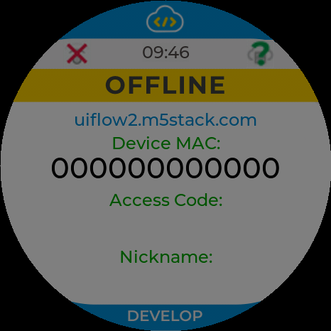
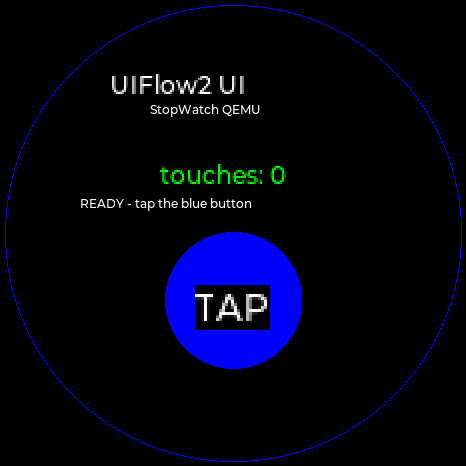
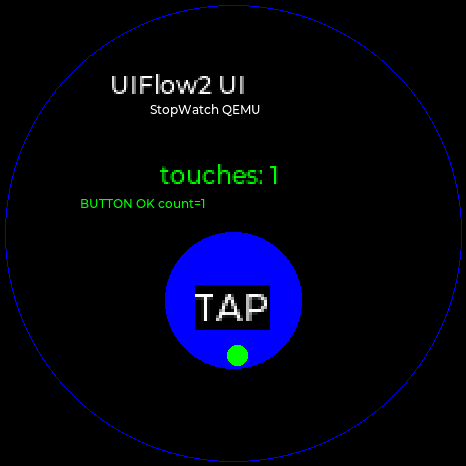

# StopWatch QEMU：官方 UIFlow2 启动修复

## 结论

官方 `UIFlow2-StopWatch-v2.5.3` merged image 已能在 `M5StopWatch-QEMU` 的 `m5stopwatch` machine 中启动到 UIFlow2 启动器，并在 CO5300 上显示 466×466 UI。



同一 QEMU 仍可启动官方 UserDemo，未出现回归。

## 圆屏说明

StopWatch 的 CO5300 控制器 framebuffer 是 466×466 的方形内存，但实际玻璃是圆形 1.75" AMOLED。QEMU 现在在输出到 console 时按内切圆裁剪四角，`screendump` 看到的是实际可见的圆形区域；framebuffer 内存本身仍是 466×466。之前的方形截图是未裁剪的原始 framebuffer，不是设备外形。

## 之前的阻塞

不是单点问题，启动链上有这些阻塞：

1. 缺少 ESP32-S3 SENS/SAR ADC 模型，UIFlow2 在 `SENS_MEAS1_DONE_SAR` 上永久等待。
2. 缺少片上模拟 I2C（regi2c）状态，ROM 在 `0x6000e050` 的 idle 状态上等待。
3. 缺少 FE/PHY 内部 ready 和计数器窗口，bootloader 在 PHY 初始化阶段停住。
4. 只有 I2C0 控制器，UIFlow2 使用 I2C1 时 probe timeout；UserDemo 则使用 I2C0。
5. M5GFX 在 GPIO47/48 上用软件 I2C 自动探测板型，QEMU 没有把 GPIO 波形桥接到 I2C 器件。
6. M5PM1 模型 ID 原为 `0x0150`，M5GFX 期望 `0x2050`。
7. 软件 I2C 读最后一个数据位时释放 SDA 过早，M5PM1 ID 被读成 `0x2151`，`_check_m5pm1()` 失败，板型无法确定为 StopWatch，AMOLED 电源/复位不执行。

## 修复内容

- 新增 `esp32s3_sens.c`、`esp32s3_regi2c.c`、`esp32s3_fe.c`、`esp32s3_phy.c` 四个 bring-up 模型；
- 新增 `esp32s3_soft_i2c.c`，把 GPIO47/48 的软件 I2C 波形桥接到 QEMU `I2CBus`；
- GPIO 模型增加 open-drain 线语义和有效线电平监听；
- I2C0/I2C1 改为两个独立控制器，共享器件总线，分别接 EXT0/EXT1 中断；
- CO5300 console 输出按 466×466 内切圆裁剪四角，匹配 StopWatch 圆形玻璃；
- 修正 M5PM1 器件 ID 为 `0x2050`。

补丁在 `patches/qemu-stopwatch-uiflow2-boot/`，基线为 `build/qemu` 的 `da100c909249926b9f4458f18e4f2d216d08f51a`。

## 复现

官方 merged image 原始大小为 `16,773,120` 字节，QEMU mtd drive 需要 16 MiB，补零后启动：

```bash
qemu-system-xtensa \
  -M m5stopwatch \
  -drive file=UIFlow2-StopWatch-v2.5.3-16MiB.bin,if=mtd,format=raw \
  -L bin/Darwin-arm64 \
  -display none \
  -serial file:uiflow2-serial.log \
  -qmp unix:/tmp/stopwatch-qmp.sock,server=on,wait=off
```

启动后通过 QMP `screendump` 取 466×466 画面。

## 本地 UIFlow2 UI 交互测试

测试工程在 [`tests/uiflow2/stopwatch_ui_test/`](../tests/uiflow2/stopwatch_ui_test/)。它只替换官方 merged image 的 `vfs` LittleFS 分区中的 `boot.py` 和 `main.py`，保留 bootloader、应用和 system 分区不变。

```bash
python3 -m pip install littlefs-python
python3 tests/uiflow2/stopwatch_ui_test/run_test.py \
  --base /path/to/UIFlow2-StopWatch-v2.5.3-16MiB.bin
```

测试脚本会：

1. 跳过 UIFlow2 启动菜单，直接运行 `/flash/main.py`；
2. 用 `M5.Display` 绘制标题、计数器和蓝色按钮；
3. 通过 QMP 注入一次触摸；
4. 比较触摸前后画面，要求出现 `touches: 1` 和 `BUTTON OK count=1`。

测试布局也按圆屏安全区设计：标题、计数器、状态和圆形按钮都在内切圆范围内。

触摸前：



触摸后：



自动化运行结果：

```text
PASS before=.../before.ppm after=.../after.ppm serial=.../serial.log
```

## 边界

- PHY/RF/ADC/温度传感器是 bring-up stub，不代表真实射频或校准精度；
- 未验证 Wi-Fi/M5Things 云端连接、Access Code 获取和 REPL 下发；
- 启动器当前是状态页，画面上的 X/问号是状态图标，不是可点击控件；
- 官方镜像需要补零到 16 MiB，原始镜像内容不变。
