# UIFlow2 外设 API 测试矩阵

日期：`2026-10-24`

本矩阵验证的是 QEMU 中的完整控制器/总线路径，而不是在 Python 测试代码里伪造
API 返回值。当前结果只代表仿真验收，不是实机验收。

## 本轮结果

| 设备 | 闭环能力 | UIFlow2 API | 结果 |
| --- | --- | --- | --- |
| StickS3 | BMI270 三轴加速度/角速度 | `Imu.getAccel()` / `getGyro()` | PASS |
| StickS3 | A/B/PWR 按键 | `BtnA` / `BtnB` / `BtnPWR` | PASS |
| StickS3 | M5PM1 电池、电压、充电 | `Power.*` | PASS |
| AtomS3R | BMI270 三轴加速度/角速度 | `Imu.getAccel()` / `getGyro()` | PASS |
| AtomS3R | BMM150 三轴磁力计 | `Imu.getMag()` | PASS |
| AtomS3R | 用户按键 | `BtnA` | PASS |
| CoreS3 | BMI270 + BMM150 | `Imu.getAccel/getGyro/getMag()` | PASS |
| CoreS3 | FT6336、PWR、AXP2101、BM8563 | Touch / Button / Power / RTC | PASS |
| CoreS3 / StackChan | LTR553 环境光与接近 | `M5.Als` | PASS |
| CoreS3 | GC0308 初始化、LCD_CAM 采集、GDMA 帧、拍照 | `camera.init()` / `camera.snapshot()` | PASS |
| StopWatch | BMI270、CST820、M5PM1、RX8130、A/B/PWR | IMU / Touch / Power / RTC / Button | PASS |
| StamPLC | PI4IOE 继电器/输入、RGB、INA226 | StamPLC / INA226Unit | PASS |
| PaperMono | BMI270、M5PM1、IP2315、RX8130、FT6336、按键、SDMMC | IMU / Power / RTC / Touch / Button / SDCard | PASS |
| StickS3 | RMT0 NEC 38 kHz 红外发送 | `hardware.IR.tx()` | PASS |
| StickS3 | RMT4 NEC 红外接收与回调 | `hardware.IR.rx_cb()` | PASS |
| PaperMono | ST25R3916 I2C NFC 检测、读页、写页回读 | `hardware.NFC` | PASS |
| PaperMono | SX1262 868 MHz 配置、TX、RX 回环 | `lora.SX1262` | PASS |
| StackChan | ST25R3916 I2C NFC 检测、读页、写页回读 | `hardware.NFC` | PASS |
| StackChan | Si12T 三点身体触摸 | `driver.si12t.Si12T` | PASS |
| StackChan | M5IOE1 12 路 NeoPixel RGB 写入/回读 | `driver.m5ioe1.RGB` | PASS |
| StackChan | SCS 总线双舵机 PING、扭矩、位置写入/回读 | `driver.scs_servo.Scscl` | PASS |
| StackChan | BMI270 加速度与陀螺仪 | `Imu.getAccel()` / `Imu.getGyro()` + I2C burst | PASS |
| StackChan | BM8563 RTC 写入、回读与走时 | `machine.I2C` 访问 PCF8563 寄存器 + QOM `unix-time` | PASS |
| StackChan | AW9523B 输出回读与注入输入 | `driver.aw9523` | PASS |
| StackChan | INA226 电压/电流/功率 | `StackChan.get_battery_*()` | PASS |
| StackChan | NEC IR TX 抓取与 RX 注入 | `hardware.IR` + RMT | PASS |
| StopWatch | M5IOE1 PWM1 振动马达开关与占空比 | `Power.setVibration()` | PASS |
| AtomS3R | LP5562 三通道 RGB PWM 写入/回读 | I2C `0x30` | PASS |
| StickS3 | ES8311/AW8737A 扬声器 I2S TX、GDMA、PCM 抓取 | `Speaker.tone()` | PASS |
| StickS3 | ES8311 麦克风 I2S RX、GDMA、PCM 注入 | `Mic.record()` | PASS |
| StopWatch | ES8311/AW8737A 扬声器 I2S TX、GDMA、PCM 抓取 | `Speaker.tone()` | PASS |
| StopWatch | ES8311 麦克风 I2S RX、GDMA、PCM 注入 | `Mic.record()` | PASS |
| CoreS3 | AW88298 扬声器 I2S TX、GDMA、PCM 抓取 | `Speaker.tone()` | PASS |
| CoreS3 | ES7210 麦克风 I2S RX、GDMA、PCM 注入 | `Mic.record()` | PASS |
| StackChan | AW88298 扬声器 I2S TX、GDMA、PCM 抓取 | `Speaker.tone()` | PASS |
| StackChan | ES7210 麦克风 I2S RX、GDMA、PCM 注入 | `Mic.record()` | PASS |
| Cardputer-ADV | ES8311/NS4150B 扬声器 I2S TX、GDMA、PCM 抓取 | `Speaker.tone()` | PASS |
| Cardputer-ADV | ES8311 麦克风 I2S RX、GDMA、PCM 注入 | `Mic.record()` | PASS |
| Cardputer-ADV | SPI microSD 初始化、512B 写入/回读、原始镜像校验 | `machine.SDCard(slot=3)` | PASS |
| Cardputer-ADV | BMI270 三轴加速度/角速度 | `Imu.getAccel()` / `getGyro()` | PASS |
| Cardputer-ADV | TCA8418 矩阵事件 FIFO、中断和按键解码 | `KeyboardI2C` | PASS |
| Cardputer-ADV | ST25R3916 SPI NFC UID、页读、页写回读 | `driver.st25r3916` | PASS |
| Cardputer-ADV | CC1101 Cap 868 MHz 配置、发送、接收回环 | `cap.CC1101Cap` | PASS |
| PaperMono | PDM 麦克风 I2S RX、GDMA、PCM 注入 | `Mic.record()` | PASS |
| PaperColor | ES8311/AW8737A 扬声器 I2S TX、GDMA、PCM 抓取 | `Speaker.tone()` | PASS |
| PaperColor | ES7210 麦克风 I2S RX、GDMA、PCM 注入 | `Mic.record()` | PASS |
| PaperColor | SPI microSD 初始化、512B 写入/回读、原始镜像校验 | `machine.SDCard(slot=2)` | PASS |
| PaperColor | SHT4X 温度/湿度命令、转换和 CRC8 | `hardware.SHT4X` | PASS |
| Core2 | NS4168 扬声器、ESP32 I2S1 linked-list DMA、AXP2101 ALDO3 使能 | `Speaker.tone()` | PASS |
| Core2 | SPM1423 PDM 麦克风、ESP32 I2S0 linked-list DMA | `Mic.record()` | PASS |
| Core2 | INA3221 ID、总线电压和分流电压寄存器 | ESP32 I2C0 | PASS |
| StamPLC | TWAI CAN G42/G43、虚拟 CAN 对端收发 | `hardware.CAN` | PASS |
| StamPLC | PWR485 UART2 G0/G39/G46、半双工 UART 对端收发 | `hardware.PWR485` | PASS |
| StamPLC | G44 I2S 1-bit ΔΣ 蜂鸣器输出 | `Speaker.tone()` + PCM 抓取 | PASS |
| Core2 | MPU6886 加速度/角速度寄存器与 `Imu` API | `Imu.getAccel()` / `getGyro()` | PASS |
| StamPLC | LM75BDP 11-bit 温度寄存器 | ESP32 I2C0 `0x48` | PASS |
| PaperColor | 两颗 WS2812/GRB RGB LED、ESP32-S3 RMT 比特流 | `M5.Led` | PASS |
| StamPLC | AW9523 四路继电器/八路输入与 PI4IOE RGB | `stamplc.StamPLC` | PASS |
| CoreS3 | AW9523 输出锁存、方向切换和注入输入 | `driver.aw9523` | PASS |
| CoreS3 | M-Bus SPI MAX3421E USB Host、Chapter 9 枚举、HID 中断端点 | `module.USBModule` | PASS |
| Tab5 | SIT3088 RS-485 半双工 TX/RX、UART1 G20/G21、方向 G34 | `machine.UART` RS-485 mode | PASS |
| Tab5 | INA226 寄存器预载进入 Power API：8000 mV / 1248 mA / 87% | `Power.getBattery*()` | PASS |
| Tab5 | RX8130 I2C 写入/回读 | `machine.I2C` 直接访问寄存器 | PARTIAL：走时和动态注入未闭环；`machine.RTC` 只改系统时间，不计为外部 RTC 证据 |
| StopWatch | M5IOE1 GPIO、ADC、PWM 与注入输入 | `driver.m5ioe1` | PASS |
| StopWatch | M5PM1 电源、GPIO/ADC/PWM、IRQ、唤醒、看门狗、定时器和 RTC RAM | `driver.m5pm1` | PASS |
| Arduino Nesso N1 | 双 PI4IOE、按键中断、BQ27220 和 AW32001 | I2C + `Power` | PASS |
| Arduino Nesso N1 | BMI270 三轴加速度/角速度 | `Imu.getAccel()` / `getGyro()` | PASS |
| Arduino Nesso N1 | SX1262 LoRa 配置、发送、接收回环 | `lora.SX1262` | PASS |
| Arduino Nesso N1 | C6 I2S TX、循环 GDMA OUT EOF、GPIO11 1-bit ΔΣ 蜂鸣器 | `Speaker.tone()` + PCM 抓取 | PASS |
| Core2 legacy | AXP192 芯片 ID、电池/VBUS/电流 ADC 与充电状态 | SoftI2C + PMIC 寄存器 | PASS |
| AtomS3R | RMT0 NEC 红外发送 | `hardware.IR.tx()` | PASS |
| Cardputer-ADV | RMT0 NEC 红外发送 | `hardware.IR.tx()` | PASS |
| PaperColor | RMT0 NEC 红外发送 | `hardware.IR.tx()` | PASS |
| NanoC6 | ESP32-C6 RMT0 NEC 红外发送 | `hardware.IR.tx()` | PASS |
| NanoC6 | GPIO19 电源使能 + GPIO20 WS2812 GRB | `hardware.RGB()` + RMT 解码 | PASS |
| NanoC6 | GPIO9 低有效按键按下/释放 | `machine.Pin` + QOM GPIO 注入 | PASS |
| NanoC6 | GPIO7 蓝色 LED 开关 | GPIO 输出寄存器 + QOM 电平观测 | PASS |
| Arduino Nesso N1 | ESP32-C6 RMT0 NEC 红外发送 | `hardware.IR.tx()` | PASS |
| StackChan | GC0308 初始化、LCD_CAM/GDMA 取帧、快照和显示 | `camera.snapshot()` | PASS |
| PaperMono | RGB 红/绿/蓝控制与 M5IOE1 PWM 回读 | `M5.Led` | PASS |

StackChan 的陀螺仪测试在固件启动后注入动态角速度，避免把 M5Unified
启动时的零偏校准误判为模型故障；官方 `Imu.getGyro()` 返回
`10.0 / -20.0 / 30.0 dps`，原始 BMI270 寄存器同步一致。RTC 通过
`machine.I2C` 直接访问 PCF8563 的 BCD 时间寄存器，验证写入、回读和走时；
`machine.RTC` 仅修改 SoC 系统时钟，不能作为外部 RTC 证据。

汇总：

```text
configured cases   67
configured checks  274
last clean full     67 cases / 274 checks PASS
last full run       2026-10-24 00:11 +08:00
attempts            1 per case
retry_used          false for every case
```

最新干净全量运行同时包含 S3 QIO read-phase、Core2 BB idle readback、
deterministic TCG/icount 和 RTC 虚拟时钟修复。67/67 用例、274/274 检查
全部通过，Core2 6 个 case 均为首轮 PASS；matrices 默认拒绝配置
`retries` 的 case，诊断重试必须显式启用 `--allow-retries`。该结果仍不等同
于物理 cache/PSRAM、RF 或真机时序验证。

NanoC6 无显示屏，额外使用 `run_nanoc6_peripherals.py` 验证 RGB、按键和蓝灯，
不计入上述需要截图的 peripheral matrix 统计。上述汇总来自全量矩阵运行；
失败重试的原始串口日志会作为 `serial.attempt-N.log` 保留。

本轮所有矩阵用例均完成“注入 -> 控制器/总线 -> 芯片模型 -> UIFlow2 API ->
屏幕/帧输出”的闭环。每个 check 的 PASS 状态由本次运行的串口、QOM、PCM、
RMT、磁盘或帧像素证据生成；没有运行时证据源的用例会被 runner 直接拒绝。

## 关键修复

### ESP32-S3 I2C FIFO 与重复起始

ESP-IDF 会以 32 位访问一次写入地址和数据。此前模型只消费首个字节，导致
BMI270 软复位后的配置上传被截断。模型现在正确处理 FIFO RAM 字节序，并在
RESTART 前结束上一次 QEMU I2C 事务，StickS3、AtomS3R 和 CoreS3 的 BMI270
初始化因此全部闭环。

### BMM150 Sensor Hub

BMM150 原始数据、轴向转换和 QOM 注入已经闭环。测试输入为
`30 / -20 / 45 uT`，AtomS3R 经板级轴变换后显示 `-30 / -19.5 / -90 uT`，
与 M5Unified 的固定轴映射一致。

### LTR553 ALS / proximity

CoreS3 与 StackChan 的 LTR553 在 I2C `0x23` 上返回 part ID `0x92` 和
manufacturer ID `0x05`；四字节 ALS 通道数据由 QOM `light-level` 注入，
11-bit PS 数据由 QOM `proximity-level` 注入。`M5.Als` 分别从
`0x88..0x8B` 和 `0x8D..0x8E` 读取，环境光 `640`、接近值 `321` 均通过。

### INA226

模型改为真实寄存器语义：

- `0x01` shunt voltage
- `0x02` bus voltage
- `0x03` power
- `0x04` current
- `0x05` calibration
- `0xFE` manufacturer ID `0x5449`
- `0xFF` die ID `0x2260`

`bus-voltage-mv`、`current-ma`、`shunt-ohms` 可通过 QOM 动态注入。StamPLC
目标值 `12.00 V / 0.500 A` 已正确回读。

### GC0308 / ESP32-S3 LCD_CAM / GDMA

新增 LCD_CAM 模型，按 `esp32-camera` 使用的 VSYNC 中断、GDMA RX 描述符和
半缓冲事件交付 RGB565 帧。官方驱动先等待 VSYNC、再写 DMA link，因此模型
增加 GDMA peripheral-start callback：VSYNC 在 DMA idle 时持续产生，link
`START` 写入时立即 arming，后续用 `esp_gdma_complete_in_descriptor()` 沿
循环描述符交付数据，而不是清除 START 后重新起链。CoreS3 与 StackChan 的
`camera.snapshot()` 均返回 `320x240 / 153600 bytes`，并通过
`M5.Display.show()` 显示；串口必须出现
`CORES3_CAMERA_PASS 320x240 153600 bytes` 才判定 PASS。

### PaperMono IP2315 充电状态

M5Unified 在 PaperMono 上不是用 M5PM1 G2 判断充电，而是临时使能 IP2315，
再读取 I2C `0x75` 的 `REG_CHG_STAT(0xC7)`：bit7 为充电中。QEMU 模型实现
充电使能位、`0x82` 充电中、`0x45` 充满/未充状态和 QOM `charging` 注入；
测试必须在串口输出 `PAPERMONO_POWER 87 4000 1`。

高带宽帧可通过宿主文件注入：

```bash
M5SW_CAMERA_FRAME=/path/frame-320x240-rgb565.raw \
PYTHONPATH=.work/py python3 tests/uiflow2/run_profile_ui_test.py ...
```

### ESP32-S3 RMT / NEC 红外

此前 SoC 中的 RMT 是 unimplemented。现在补了 RMT APB 配置寄存器、
`RMTMEM` 硬件符号内存、通道状态和 `TX_END/RX_END` 中断：

- TX：UIFlow2 `hardware.IR.tx()` 编码到 RMT0，QEMU 从 RMTMEM 读取 34 个
  NEC 符号，解码回地址 `0x56`、命令 `0xA3`；
- RX：宿主把 34 个 NEC 符号写入 RMT4 硬件内存并触发 RX_END，
  `hardware.IR.rx_cb()` 收到 `address=0x56 / data=0xA3`，UI 成功标记变绿。

相关文件：

```bash
M5SW_RMT_TX_FILE=/tmp/ir.rmt
M5SW_RMT_RX_FILE=/tmp/nec-56-a3.rmt
```

NEC 捕获/注入格式为小端 `rmt_symbol_word_t` 序列。

### ST25R3916 I2C NFC

PaperMono 与 StackChan 的 NFC 使用 ST25R3916 I2C 模式（地址 `0x50`）。模型
实现命令/寄存器/FIFO 协议和 ISO14443A 标签交互，而不是在 Python 中伪造
`detect()`：

- REQA/WUPA 返回 ATQA；
- anticollision 返回 UID + BCC；
- SELECT 返回 SAK；
- GET_VERSION 识别 Type 2/NTAG；
- Type 2 READ 从标签页返回数据和 CRC 占位；
- WRITE_PAGE 更新标签页，随后 READ 回读一致。

两台设备均检测到 UID `DEADBEEF`，PaperMono 写入/回读 page 8 的 `TEST`，
StackChan 写入/回读 page 12 的 `CHAN`。

### PaperMono SX1262 LoRa

PaperMono 使用独立 SPI3 控制器连接 SX1262。模型实现命令状态、参数、寄存器、
TX/RX FIFO、IRQ、RSSI/SNR 和本地 TX 到 RX 的回环数据面。测试通过 native
`lora.SX1262` 完成：

- `SET_STANDBY`、TCXO、DIO2 RF switch 和 IRQ 配置；
- 868 MHz、SF7、125 kHz、CR 4/5 调制配置；
- `WRITE_BUFFER("M5LORA")` 与 `SET_TX`；
- `SET_RX`、`GET_IRQ_STATUS`、`GET_RX_BUFFER_STATUS` 和 `READ_BUFFER`；
- UI 回读 `packet=b'M5LORA' / status=ok`。

测试适配层保持 CS 连续，并把单次 SPI 传输切成不超过 4 字节。这个适配绕过
了当前仿真中尚未闭环的 IDF `spi_device_acquire_bus()` 大于 4 字节事务路径；
数据仍经过真实 GP-SPI 寄存器、GDMA 和 SX1262 模型，不是在 Python 中直接构造
LoRa 返回值。

### StackChan Si12T 身体触摸

Si12T 在 `0x68` 上完成寄存器配置，QOM `touch-bits` 注入后，
`get_touch_status()` 解码出 `[2, 0, 0]`，屏幕绘制成功标记。

### StackChan M5IOE1 RGB

官方 M5IOE1 NeoPixel 驱动通过 I2C 配置 12 颗 RGB，写入红色后从 LED RAM
读回 RGB565 `0xF800`，验证的是扩展器寄存器数据面。

### StackChan SCS 舵机

UIFlow2 通过 UART1（TX GPIO6、RX GPIO7、1 Mbps）使用官方
`driver.scs_servo.Scscl`。QEMU 的 SCSCL 模型从真实 UART TX 字节流解析
`PING`、`WRITE` 和 `READ` 帧，并校验帧尾 checksum：

- ID 1/2 PING 分别返回自身 ID；
- torque enable 写入寄存器 40；
- X/Y 目标位置写入 `500/300`；
- present position 从寄存器 56 回读 `500/300`；
- UI 显示 `status=ok`。

为使该路径可通过，ESP32-S3 系统时钟模型同时补齐了 UART0/1/2 的
`PERIP_CLK_EN` 和 `PERIP_RST_EN` 复位值及读写语义。

### I2S/GDMA 音频数据面

QEMU 的 I2S 模型现在区分 TX/RX，并按真实 GDMA 循环描述的语义逐缓冲区完成：

- TX：ES8311/AW88298/AW8737A 配置完成后，扬声器驱动写入 I2S DMA；
  模型逐个描述符产生 `OUT_EOF`，宿主将实际 PCM 写到
  `M5SW_I2S_PCM_FILE`；
- RX：宿主通过 `M5SW_I2S_RX_PCM_FILE` 注入 16-bit PCM，模型写入 I2S RX
  的 GDMA 描述符并产生 `IN_SUC_EOF`，UIFlow2 `Mic.record()` 可以读到真实
  非静音数据；
- C6：GDMA 使用和 C3 不同的 `IN[3] + OUT[3]` 独立中断寄存器布局；模型按
  `OUT_CH1.INT_ENA`、`OUT_CH1.INT_CLR` 和 `OUT_EOF` 的真实偏移推进循环
  描述符，并调用 I2S TX 完成回调，不能用只读快照代替 DMA 轮转；
- 设备覆盖 StickS3、StopWatch、CoreS3、StackChan、Cardputer-ADV 和
  PaperColor；PaperMono 的 PDM RX 路径走同一 I2S/GDMA 数据面；Nesso N1
  的 GPIO11 1-bit ΔΣ 蜂鸣器走 C6 I2S TX 与 AHB GDMA。

StickS3 扬声器抓取的 64 KiB PCM 有 18410 个非零样本，峰峰值 2881；
CoreS3 扬声器抓取峰峰值 11523，均来自固件实际 I2S 写入而不是 Python 伪造。

Nesso N1 蜂鸣器抓取 48128 字节 PCM，非零样本 12866，峰峰值 65535；测试同时
要求 `Speaker.isPlaying()` 为真，避免只验证任务启动。

### SPI microSD

GP-SPI 从设备模型实现了 SD SPI 命令状态机：

- CMD0/8/9/10/13/16/17/24/51/55/58/59；
- ACMD41、ACMD13、ACMD51；
- R1/R2/R3/R7、数据 token、CRC16 和 512 字节单块读写；
- `M5SW_SPI_SD_IMAGE` 指定原始 SD 镜像，写入后主机可直接校验扇区内容。

Cardputer-ADV 使用 `SCK=G40 / MOSI=G14 / MISO=G39 / CS=G12`，PaperColor
使用 `SCK=G15 / MOSI=G13 / MISO=G14 / CS=G47`，两者都通过
`machine.SDCard` 完成写入和回读，未在 Python 侧伪造块数据。

### PaperColor SHT4X

SHT4X 通过 ESP32-S3 I2C 完成测量命令、温度/湿度转换和两段 CRC8 校验；
官方 `hardware.SHT4X.measure()` 返回默认注入的 `25 °C / 50 %RH` 范围值。

### Core2 v1.1 NS4168 与 SPM1423

Core2 固件 SKU 为 `K010-V11`，官方原理图对应 AXP2101 + INA3221，而不是旧版
Core2 的 AXP192。板级模型已改为 AXP2101，扬声器使用 ESP32 I2S1，麦克风
使用 I2S0 PDM RX。

同一 `m5core2` 机器可通过 `M5SW_CORE2_PMIC=axp192` 选择 legacy PMIC；
SoftI2C 路径已验证 AXP192 ID、状态、电池电压和充放电电流，默认 AXP2101 +
INA3221 路径保持独立回归。

QEMU 直接读取 IDF 生成的 `lldesc_t` 描述符链：

- TX：逐个消费 guest DMA 描述符，触发 `OUT_EOF`，宿主抓到 32768 字节 PCM，
  非零样本 16356，峰峰值 46091；
- RX：向 guest RX 描述符写入确定性 PCM，触发 `IN_SUC_EOF`，官方
  `Mic.record()` 录到非静音数据；
- NS4168 功放使能由 AXP2101 ALDO3 控制，QOM 断言
  `/machine/axp2101 speaker-enabled=true` 通过。

### Core2 v1.1 INA3221

INA3221 在 ESP32 I2C0 的 `0x40/0x41` 地址上提供三通道电源监控。测试注入
CH1 `4800 mV / 240 mA`，固件通过真实 I2C 传输读取：

- die ID `0x3220`；
- bus voltage raw `600`，对应 `4800 mV / 8 mV`；
- shunt voltage raw `60`，对应 `240 mA × 10 mΩ / 40 uV`。

### StamPLC CAN、RS485 与蜂鸣器

官方 StamPLC 资料确认：

- PWR-CAN：`CAN_TX=G42`、`CAN_RX=G43`，由 ESP32-S3 TWAI 控制；
- PWR-485：`RS485_TX/BOOT=G0`、`RS485_RX=G39`、`RS485_DIR=G46`，使用
  UART2 半双工模式；
- 蜂鸣器：`G44`，M5Unified 使用 I2S 1-bit ΔΣ 数据流，而不是普通 GPIO
  PWM。

QEMU 为 TWAI 连接一个真实 CAN-bus 虚拟节点。官方 `hardware.CAN` 发送
标准帧 `ID=0x123 / data=M5CAN!`，对端回送后 UIFlow2 成功接收同一帧。

PWR485 通过 UART2 的 TX 字节回调连接虚拟 RS485 节点，`PWR485.write()` 的
`M5RS485` 经 UART 控制器发出并回注 RX，`read()` 回读一致。

蜂鸣器测试由官方 `Speaker.tone(3500, 250)` 生成 I2S 数据，宿主抓到 65536
字节 PCM，非零样本 18432，峰峰值 60855。

### Core2 MPU6886 与 StamPLC LM75

MPU6886 的 14 字节 accel/temp/gyro burst 使用大端 16 位样本。原模型把高低
字节顺序返回反了，修复后 QOM 注入
`accel=(0.25,-0.50,0.75) g / gyro=(10,-20,30) dps`，官方
`Imu.getAccel()/getGyro()` 精确回读。

LM75BDP 在 StamPLC I2C0 `0x48` 上注入 `37.5 °C`，原始寄存器为
`0x2580`，按 11-bit 二进制补码和 `1/8 °C` LSB 解码为 `37.5 °C`。

### PaperColor RGB LED

PaperColor 的两颗板载 RGB LED 使用 ESP32-S3 RMT 输出 WS2812/GRB 波形。
官方 `M5.Led.setColor()` 设置第一颗红色、第二颗绿色后，QEMU 从 RMTMEM
抓取 48 个 symbol，宿主按高电平宽度区分 T0H/T1H，解码出：

```text
00 ff 00  ff 00 00
```

对应 GRB 线上的红、绿两色，而不是在 Python 中直接伪造 LED 状态。

### StamPLC AW9523 与 PI4IOE 分工

官方原理图确认继电器和光耦输入由 AW9523B `0x59` 控制，前面板按键和
RGB LED 由 PI4IOE5V6408 `0x43` 控制。测试通过 AW9523 写入 relay 1
并回读，QOM 注入 `input-bits=0xF0F0` 后八路输入全部为高；PI4IOE 的红色
通道写入后同样回读一致。

### StopWatch 振动马达

`Power.setVibration(128)` 写入 M5IOE1 PWM1 的 12 位占空比和 enable 位，
模型回读 duty `2055`；再次调用 `setVibration(0)` 后 enable 清零。

### AtomS3R LP5562

LP5562 在 I2C `0x30` 上完成 enable/mode 配置，独立写入 R/G/B PWM
`0x80/0x40/0x20` 后逐寄存器回读一致。

## 运行

```bash
PYTHONPATH=.work/py python3 tests/uiflow2/run_peripheral_matrix.py \
  --out-dir /tmp/m5-uiflow2-peripheral-matrix
```

源码：

- `tests/uiflow2/sticks3_peripherals/`
- `tests/uiflow2/atoms3r_peripherals/`
- `tests/uiflow2/cores3_peripherals/`
- `tests/uiflow2/cores3_camera/`
- `tests/uiflow2/stamplc_peripherals/`
- `tests/uiflow2/stopwatch_peripherals/`
- `tests/uiflow2/sticks3_ir/`
- `tests/uiflow2/sticks3_ir_rx/`
- `tests/uiflow2/papermono_nfc/`
- `tests/uiflow2/papermono_lora/`
- `tests/uiflow2/papermono_spi_probe/`
- `tests/uiflow2/stackchan_nfc/`
- `tests/uiflow2/stackchan_touch/`
- `tests/uiflow2/stackchan_rgb/`
- `tests/uiflow2/stackchan_servo/`
- `tests/uiflow2/stopwatch_vibration/`
- `tests/uiflow2/atoms3r_lp5562/`
- `tests/uiflow2/sticks3_audio/`
- `tests/uiflow2/sticks3_mic/`
- `tests/uiflow2/cores3_audio/`
- `tests/uiflow2/cores3_mic/`
- `tests/uiflow2/stackchan_audio/`
- `tests/uiflow2/stackchan_mic/`
- `tests/uiflow2/stopwatch_audio/`
- `tests/uiflow2/stopwatch_mic/`
- `tests/uiflow2/cardputer_adv_audio/`
- `tests/uiflow2/cardputer_adv_mic/`
- `tests/uiflow2/cardputer_adv_sd/`
- `tests/uiflow2/cardputer_adv_peripherals/`
- `tests/uiflow2/cardputer_adv_nfc/`
- `tests/uiflow2/cardputer_adv_cc1101/`
- `tests/uiflow2/papermono_mic/`
- `tests/uiflow2/papercolor_audio/`
- `tests/uiflow2/papercolor_mic/`
- `tests/uiflow2/papercolor_sd/`
- `tests/uiflow2/papercolor_sht4x/`
- `tests/uiflow2/core2_audio/`
- `tests/uiflow2/core2_mic/`
- `tests/uiflow2/core2_power_monitor/`
- `tests/uiflow2/stamplc_can/`
- `tests/uiflow2/stamplc_rs485/`
- `tests/uiflow2/stamplc_buzzer/`
- `tests/uiflow2/core2_imu/`
- `tests/uiflow2/stamplc_lm75/`
- `tests/uiflow2/papercolor_rgb/`
- `tests/uiflow2/stamplc_onboard_io/`
- `tests/uiflow2/nesso_imu/`
- `tests/uiflow2/nesso_lora/`

## 新增外设数据面

### BMI270

Nesso N1 的 BMI270 位于 I2C `0x68`。模型实现 `CHIP_ID`、软复位、
`INIT_DATA/INIT_CTRL`、数据就绪状态和 little-endian accel/gyro 采样寄存器；
QOM 注入 `0.25 / -0.50 / 0.75 g` 和 `10 / -20 / 30 dps` 后，官方
`Imu.getAccel()` / `Imu.getGyro()` 返回一致值。

### SX1262 LoRa

Nesso N1 的 ST7789 和 SX1262 共用 `G20/G21/G22`，分别由 `G17/G23` 选通。
测试通过 `lora.SX1262` 驱动完成 868 MHz/SF7/125 kHz 配置、发送 `M5LORA`
并从芯片 packet FIFO 回读相同数据。C6 SPI2 控制器补齐 DMA `TRANS_DONE`
状态；SX1262 模型在 GPIO 位流上实现命令、参数、状态、寄存器、IRQ 和
TX/RX FIFO 协议，不在 Python 层替换返回值。

> `hardware.LoRa` 包装器会重新初始化 ST7789 已占用的硬件 SPI2；本测试使用
> 同一官方 `lora.SX1262` 驱动和 `machine.SoftSPI` 走相同的四个物理 GPIO。

### Cardputer-ADV ST25R3916 SPI

Cardputer-ADV 的 SPI2 同时挂载 microSD、ST25R3916 NFC 和未来 CC1101。
模型允许同一控制器按 CS 选择多个 SPI 从设备，并通过稳定的 MISO 缓冲
把读数据交付给 IDF DMA 路径。NFC 测试通过 SCLK `G40`、MOSI `G14`、
MISO `G39`、NFC CS `G6` 读取 UID `DEADBEEF`、page4 `M5N1`，写入并回读
page8 `TEST`；同一轮 SD CS `G12` 与 BMI270 路径同时 PASS。

### Cardputer-ADV CC1101 Cap

CC1101 与 SD、NFC 共用 SPI2，使用 CS `G5`、GDO0 `G15`。官方
`cap.CC1101Cap` 配置 868 MHz、2.4 kbps、25.4 kHz 频偏、58 kHz RX 带宽和
10 dBm 输出，发送 `M5CC1101` 后通过芯片状态寄存器/FIFO 回读一致。

## 屏幕证据

### StickS3

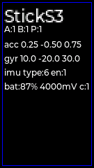

### AtomS3R

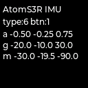

### CoreS3

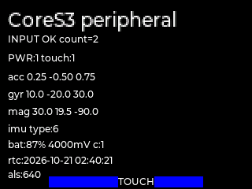

### CoreS3 camera

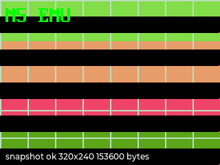

### StamPLC

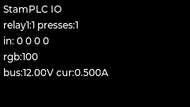

### StopWatch

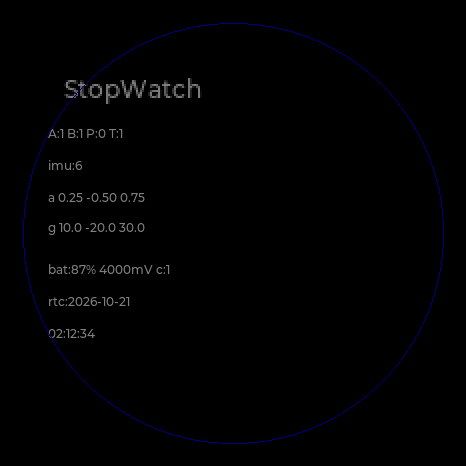

### PaperMono

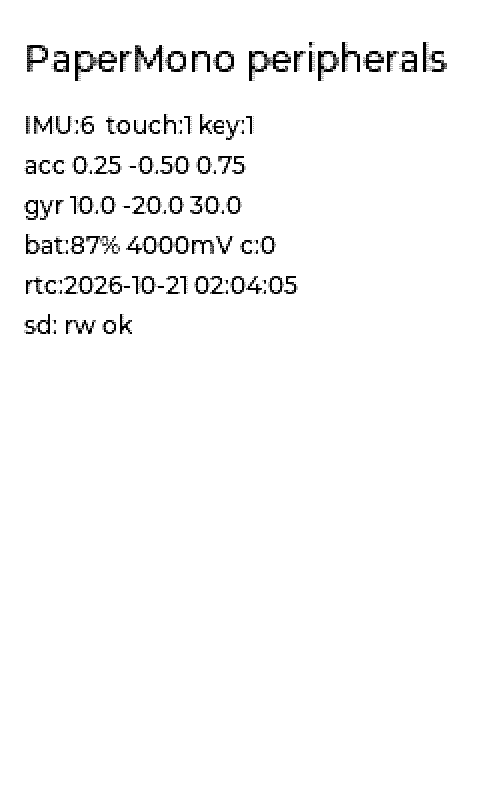

### StickS3 IR TX

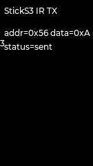

### StickS3 IR RX

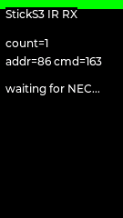

### PaperMono NFC

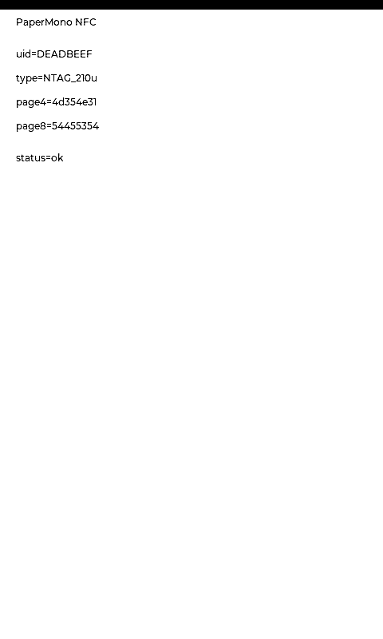

### PaperMono SX1262 LoRa


### StackChan NFC

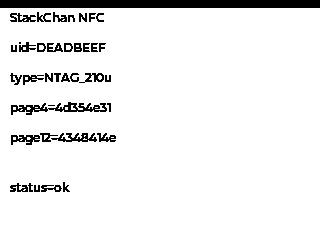

### StackChan Si12T touch

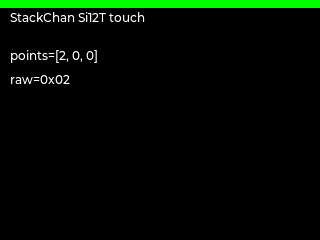

### StackChan RGB

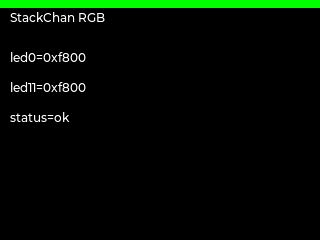

### StackChan SCS servo


### StopWatch vibration

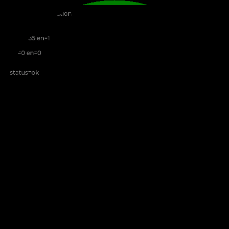

### AtomS3R LP5562

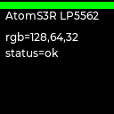

### Audio and SD data planes

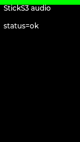

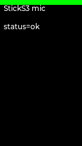

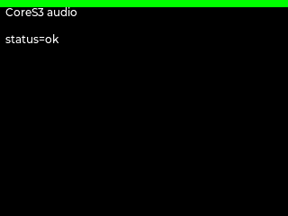

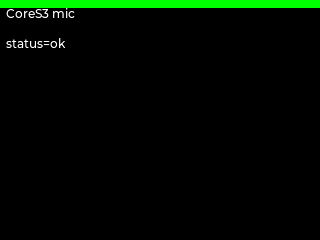


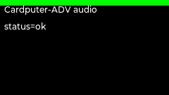

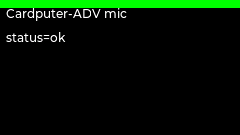

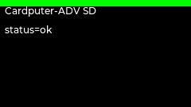

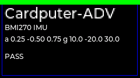

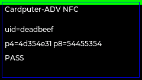

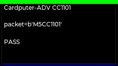


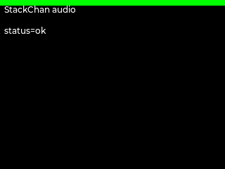

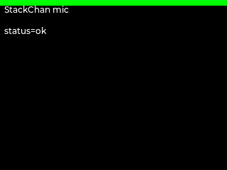

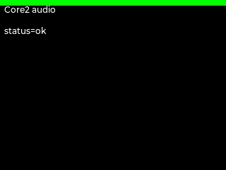

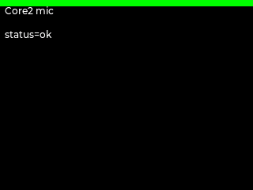

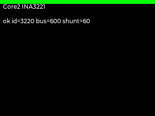

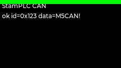

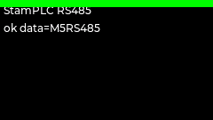

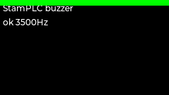

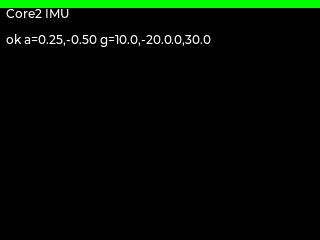

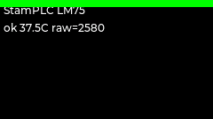

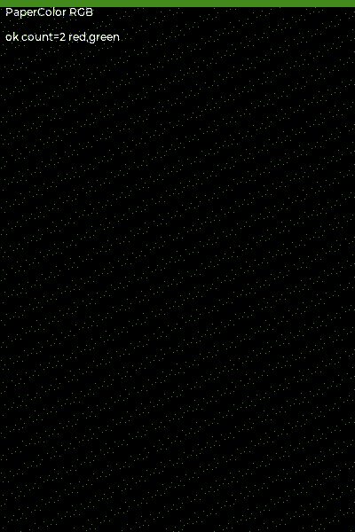

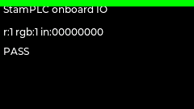

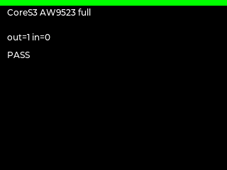

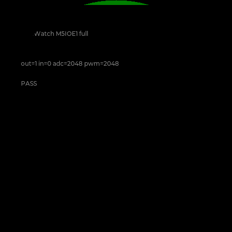

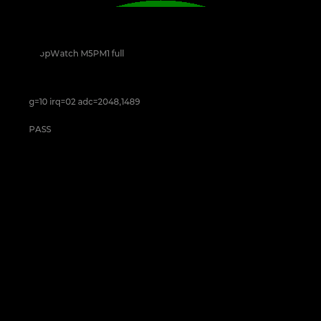


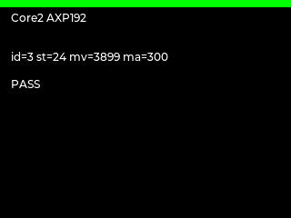

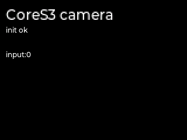


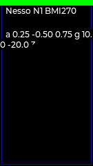

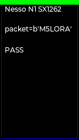


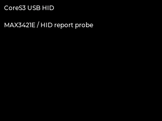

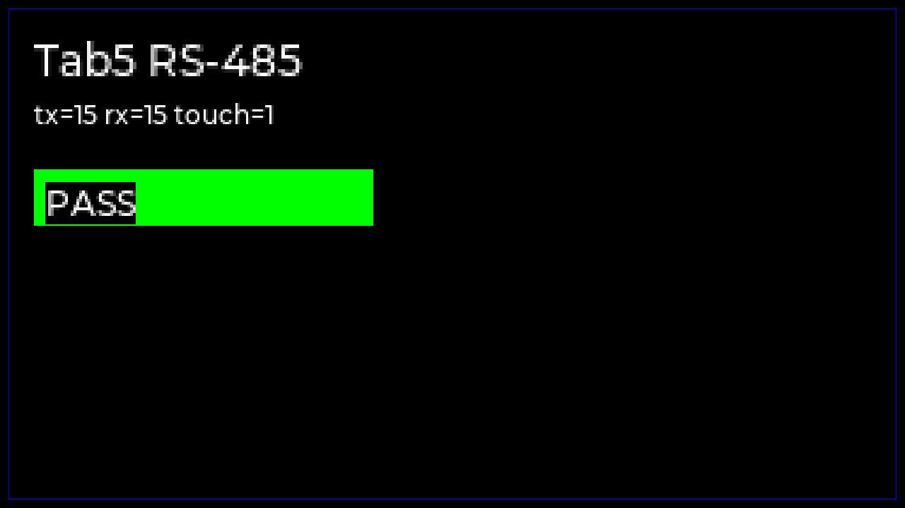

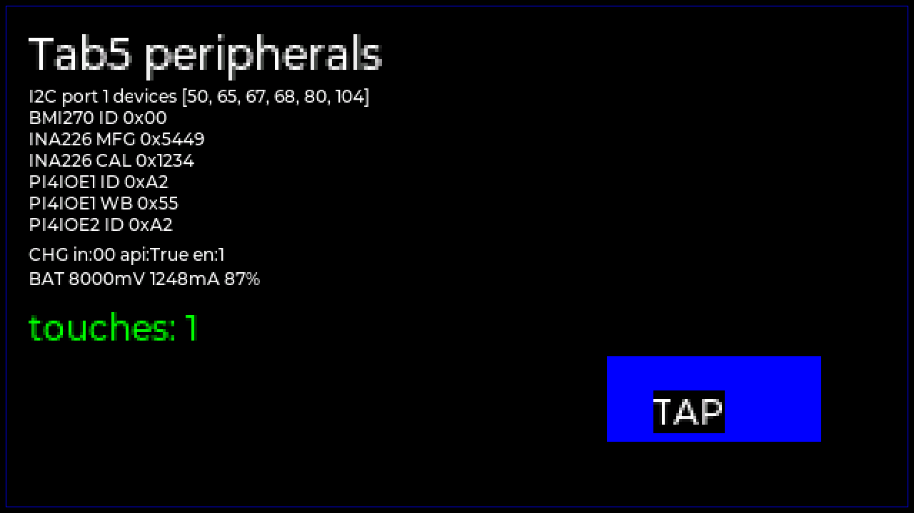

## 设备级调度

`runtime-coverage.json` 的 `device_case_groups` 把 67 个 matrix case 和
7 个 external probe 分别绑定到 14 台设备，并声明每组覆盖的模拟模型。
每个 case 必须且只能归属一个设备组。

```bash
python3 tests/uiflow2/run_peripheral_matrix.py \
  --device stackchan --out-dir /tmp/m5-stackchan-peripherals
python3 tests/uiflow2/run_peripheral_matrix.py \
  --device stackchan --list-json
```

设备中心还可以从 `GET /api/peripherals/<device>` 的 `runtime_cases` 和
`GET /api/peripheral-interfaces` 直接取得调度用例、QOM/QMP 属性和数据通道。

## 尚未闭环

- Tab5 BMI270 动态模型、SC2356/MIPI-CSI、ES8388/ES7210 I2S/PCM、
  P4 USB Host、SDIO 和 ST7123 真实寄存器数据面；其
  INA226、两颗 PI4IOE 和 RX8130 已完成 P4 I2C 寄存器读写验证，但动态注入
  与 GPIO/中断副作用仍未闭环。SIT3088 RS-485 已通过；
- CardputerZero 剩余 AW8737A 模拟电气链路和 USB split transaction
  逐包时序精度；ES8389、IP2315、GL852G MTT、SR9900A/r8152、IMX219
  Unicam 和 GPIO IR 数据面均已通过；
- 所有项目的真机复测。

这些项目已在 `platform/peripherals/catalog.json` 中逐器件登记。每个
`simulated` 模型必须有数据面、注入接口和已验证设备；每个 `partial/planned`
模型和设备阻塞必须一一对应。CI 会阻止新增设备只做显示/触摸而漏掉传感器、
总线、执行器或数据端点，也会阻止把其他板型上的芯片模型直接冒充当前板型
闭环。
