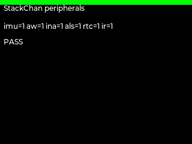

# StackChan peripheral probe

Exercises the StackChan/CoreS3 I2C and RMT paths:

- BMI270 accelerometer and gyroscope;
- BM8563-compatible PCF8563 RTC write/read, progression and QOM time injection;
- AW9523B output latch and injected input;
- INA226 battery voltage/current/power through `hardware.stackchan`;
- NEC IR TX capture and RX injection on GPIO5/GPIO10.

The BMI270 raw accelerometer/gyro block is read directly from I2C registers in
addition to the official `Imu.getAccel()` / `Imu.getGyro()` APIs. Gyro values
are injected after firmware boot so the test exercises live sampling rather
than M5Unified's boot-time zero calibration. The RTC check writes and reads
the BM8563-compatible PCF8563 BCD registers directly through `machine.I2C`
at address 0x51 and verifies that the seconds counter advances. `machine.RTC`
is not used because it only controls the ESP32 system clock.

Run through the peripheral matrix:

```bash
PYTHONPATH=.work/py python3 tests/uiflow2/run_peripheral_matrix.py \
  --case stackchan-peripherals
```


